<p align="center"><b>English</b> · <a href="README.zh-TW.md">繁體中文</a></p>

# SwiftUI Motion Library

**A browsable collection of copy-paste SwiftUI motion effects, each with live preview, usage code and an AI prompt.**

Inspired by web motion galleries, built for SwiftUI developers who would rather drop in a polished effect than spend an afternoon tuning springs.

---

## Why

Web developers have huge motion galleries organised by *what* you animate and *when*. SwiftUI has great one-off repos and a few focused packages, but no single place to browse effects by **component × trigger**, try them, and take the code. This repo aims to be that place.

Every effect ships with:

- **A reusable API**: a `View`, `ViewModifier` or `ButtonStyle`, with no dependencies.
- **A live demo** in the bundled gallery.
- **Usage code** you can copy.
- **An AI prompt** that describes the look and the technique, so you can paste it into Claude, ChatGPT or Copilot to adapt it.
- **Reduce Motion support** for anything that loops or moves a lot.

Effects are grouped by component: text, buttons, cards, shapes, backgrounds, numbers, particles & 3D and transitions.

## Effects

<!-- effects:start (generated by Scripts/generate-docs.sh; edit MotionCatalog.swift instead) -->
<p align="center"><b>73 effects</b> in 8 categories</p>

<table align="center">
<tr>
<td align="center" width="25%">
🔤<br>
<a href="#text"><b>Text</b></a><br>
<sub>14 effects</sub>
</td>
<td align="center" width="25%">
🔘<br>
<a href="#button"><b>Button</b></a><br>
<sub>13 effects</sub>
</td>
<td align="center" width="25%">
🃏<br>
<a href="#card--group"><b>Card &amp; Group</b></a><br>
<sub>12 effects</sub>
</td>
<td align="center" width="25%">
🔷<br>
<a href="#shape"><b>Shape</b></a><br>
<sub>10 effects</sub>
</td>
</tr>
<tr>
<td align="center" width="25%">
🌈<br>
<a href="#background"><b>Background</b></a><br>
<sub>7 effects</sub>
</td>
<td align="center" width="25%">
🔢<br>
<a href="#number"><b>Number</b></a><br>
<sub>1 effect</sub>
</td>
<td align="center" width="25%">
✨<br>
<a href="#particle--3d"><b>Particle &amp; 3D</b></a><br>
<sub>9 effects</sub>
</td>
<td align="center" width="25%">
🎬<br>
<a href="#transition"><b>Transition</b></a><br>
<sub>7 effects</sub>
</td>
</tr>
</table>

### Text

<table>
<tr>
<td align="center" valign="top" width="33%">
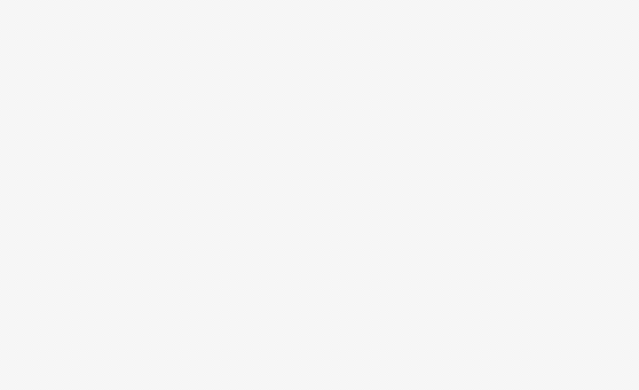<br>
<b>Typewriter</b><br>
<sub>Appear / Value change</sub><br>
<code>TypewriterText(&quot;…&quot;)</code>
</td>
<td align="center" valign="top" width="33%">
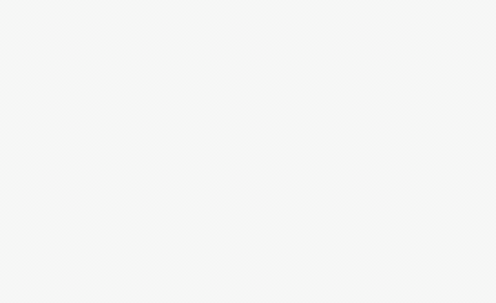<br>
<b>Scramble / Decode</b><br>
<sub>Appear / Value change</sub><br>
<code>ScrambleText(&quot;…&quot;)</code>
</td>
<td align="center" valign="top" width="33%">
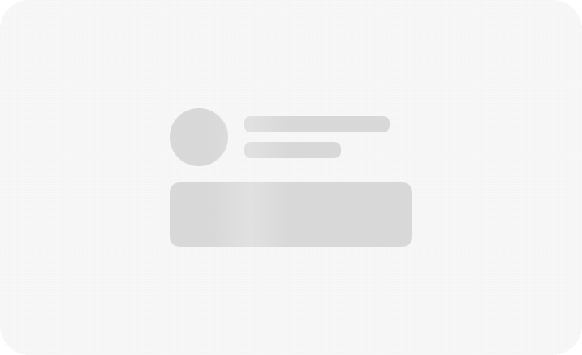<br>
<b>Shimmer</b><br>
<sub>Loop</sub><br>
<code>.shimmer()</code>
</td>
</tr>
<tr>
<td align="center" valign="top" width="33%">
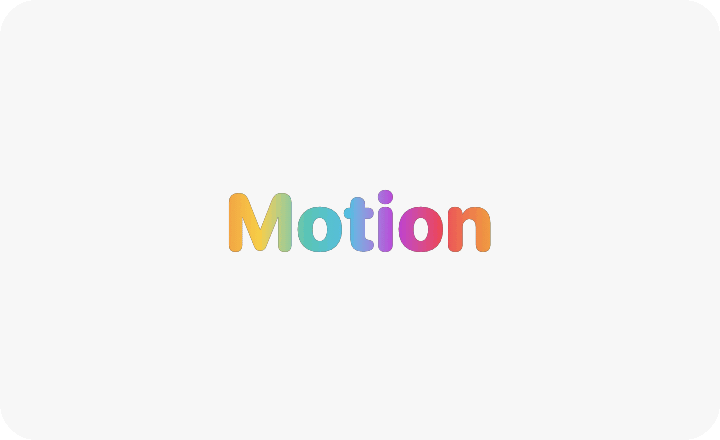<br>
<b>Gradient Sweep</b><br>
<sub>Loop</sub><br>
<code>.gradientSweep()</code>
</td>
<td align="center" valign="top" width="33%">
<br>
<b>Blur-in Words</b><br>
<sub>Appear / Value change</sub><br>
<code>BlurInText(&quot;…&quot;)</code>
</td>
<td align="center" valign="top" width="33%">
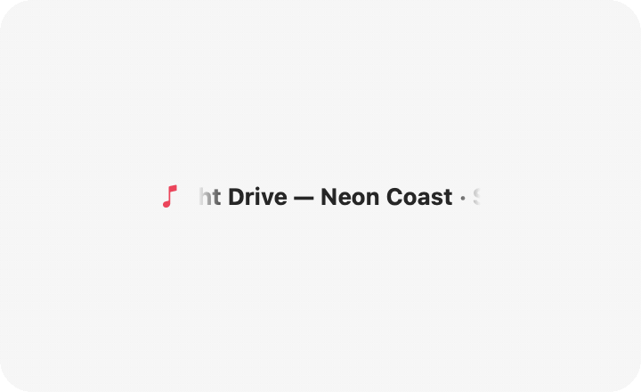<br>
<b>Marquee</b><br>
<sub>Loop</sub><br>
<code>MarqueeText(&quot;…&quot;)</code>
</td>
</tr>
<tr>
<td align="center" valign="top" width="33%">
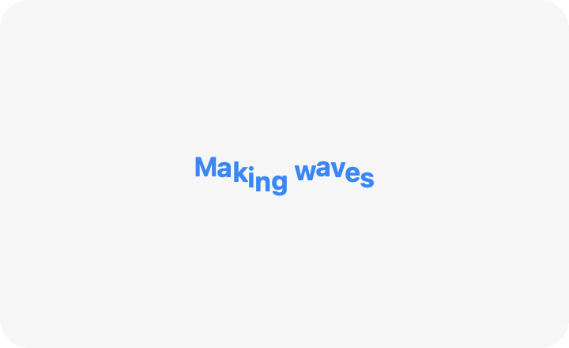<br>
<b>Wave Text</b><br>
<sub>Loop · iOS 18+</sub><br>
<code>WaveText(&quot;…&quot;)</code>
</td>
<td align="center" valign="top" width="33%">
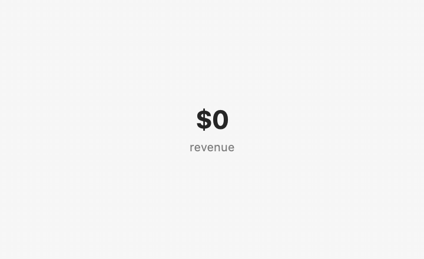<br>
<b>Count Up</b><br>
<sub>Appear / Value change</sub><br>
<code>CountUpText(value: …)</code>
</td>
<td align="center" valign="top" width="33%">
<br>
<b>Split Text</b><br>
<sub>Appear / Value change · iOS 18+</sub><br>
<code>SplitText(&quot;…&quot;)</code>
</td>
</tr>
<tr>
<td align="center" valign="top" width="33%">
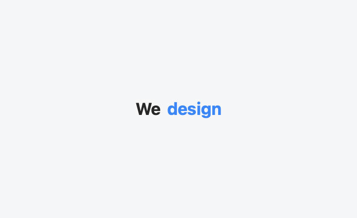<br>
<b>Rotating Text</b><br>
<sub>Loop</sub><br>
<code>RotatingText([…])</code>
</td>
<td align="center" valign="top" width="33%">
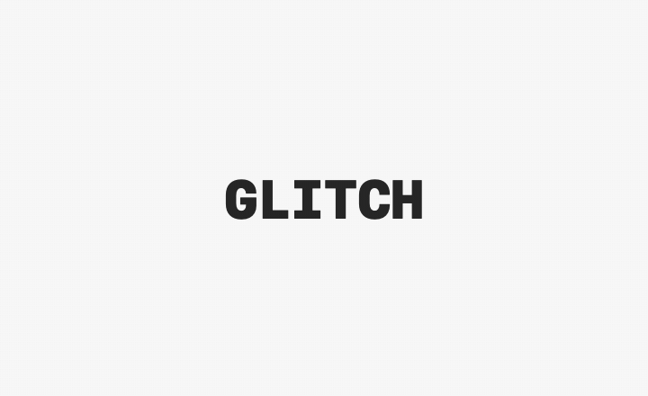<br>
<b>Glitch</b><br>
<sub>Loop</sub><br>
<code>.glitch()</code>
</td>
<td align="center" valign="top" width="33%">
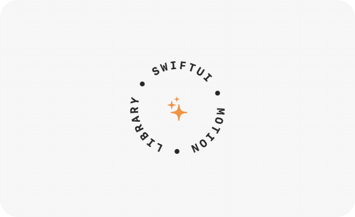<br>
<b>Circular Text</b><br>
<sub>Loop</sub><br>
<code>CircularText(&quot;…&quot;)</code>
</td>
</tr>
<tr>
<td align="center" valign="top" width="33%">
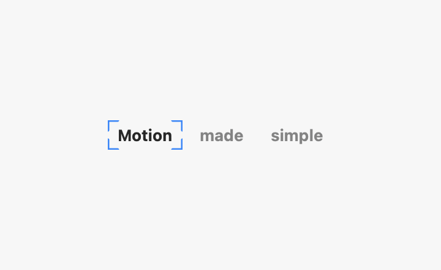<br>
<b>Focus Text</b><br>
<sub>Loop</sub><br>
<code>FocusText(&quot;…&quot;)</code>
</td>
<td align="center" valign="top" width="33%">
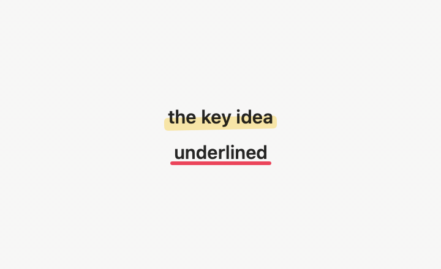<br>
<b>Highlighter</b><br>
<sub>Appear / Value change</sub><br>
<code>.highlighter()</code>
</td>
</tr>
</table>

### Button

<table>
<tr>
<td align="center" valign="top" width="33%">
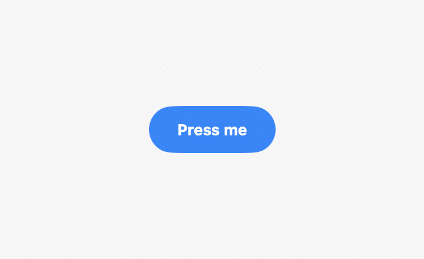<br>
<b>Pressable</b><br>
<sub>Press</sub><br>
<code>.buttonStyle(.pressable)</code>
</td>
<td align="center" valign="top" width="33%">
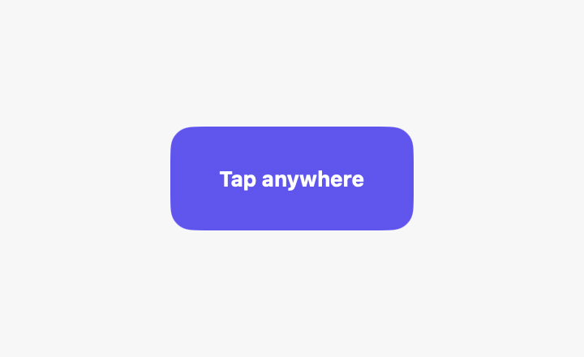<br>
<b>Tap Ripple</b><br>
<sub>Tap</sub><br>
<code>.ripple()</code>
</td>
<td align="center" valign="top" width="33%">
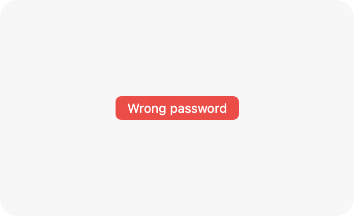<br>
<b>Error Shake</b><br>
<sub>Value change</sub><br>
<code>.shake(trigger:)</code>
</td>
</tr>
<tr>
<td align="center" valign="top" width="33%">
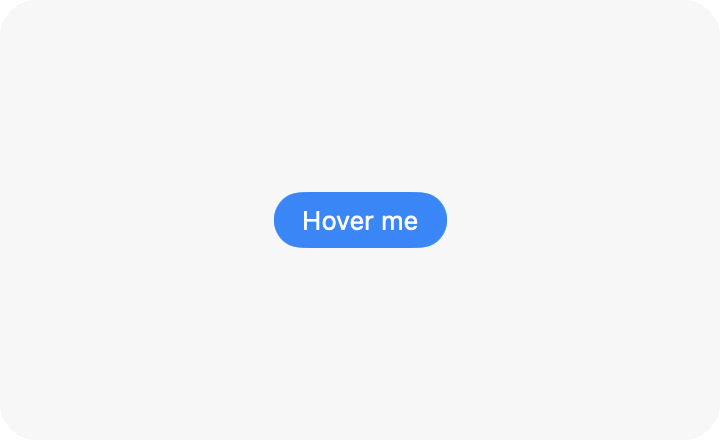<br>
<b>Magnetic Button</b><br>
<sub>Hover / Drag</sub><br>
<code>.magnetic()</code>
</td>
<td align="center" valign="top" width="33%">
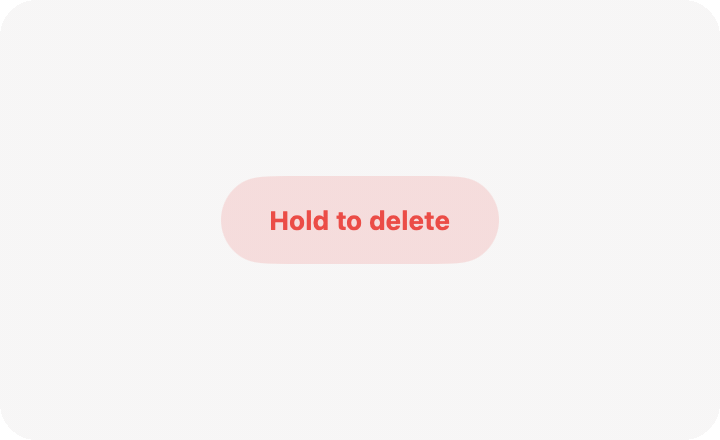<br>
<b>Hold to Confirm</b><br>
<sub>Press</sub><br>
<code>HoldToConfirmButton(&quot;…&quot;) { }</code>
</td>
<td align="center" valign="top" width="33%">
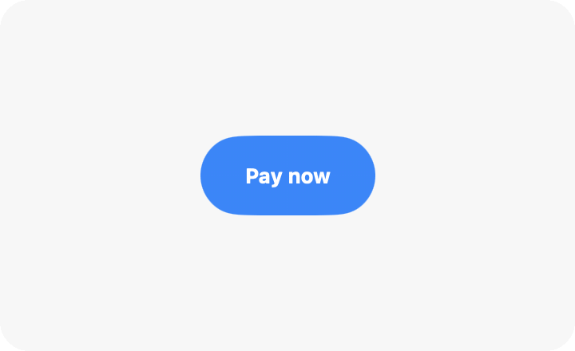<br>
<b>Loading → Success</b><br>
<sub>Tap / Value change</sub><br>
<code>StatusButton(&quot;…&quot;, status:) { }</code>
</td>
</tr>
<tr>
<td align="center" valign="top" width="33%">
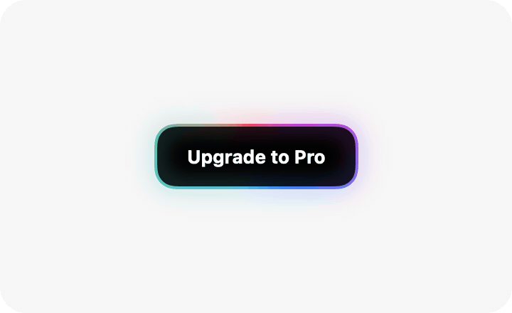<br>
<b>Glow Border</b><br>
<sub>Loop</sub><br>
<code>.glowBorder()</code>
</td>
<td align="center" valign="top" width="33%">
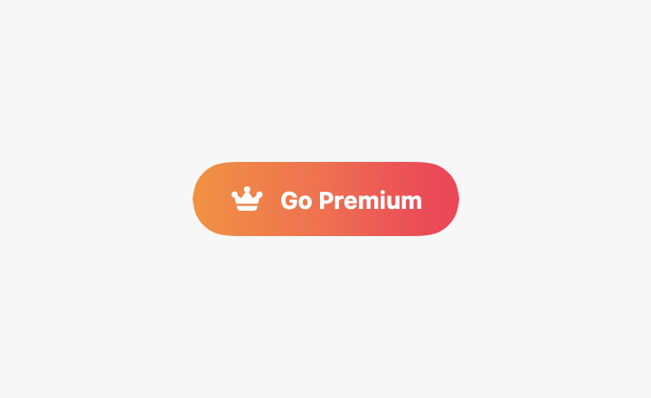<br>
<b>Shine</b><br>
<sub>Value change / Loop</sub><br>
<code>.shine(every:) / .shine(trigger:)</code>
</td>
<td align="center" valign="top" width="33%">
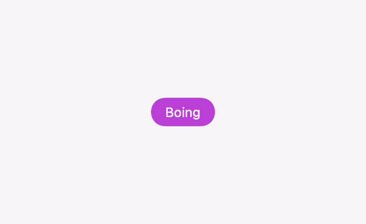<br>
<b>Jelly</b><br>
<sub>Tap / Value change</sub><br>
<code>.jelly(trigger:)</code>
</td>
</tr>
<tr>
<td align="center" valign="top" width="33%">
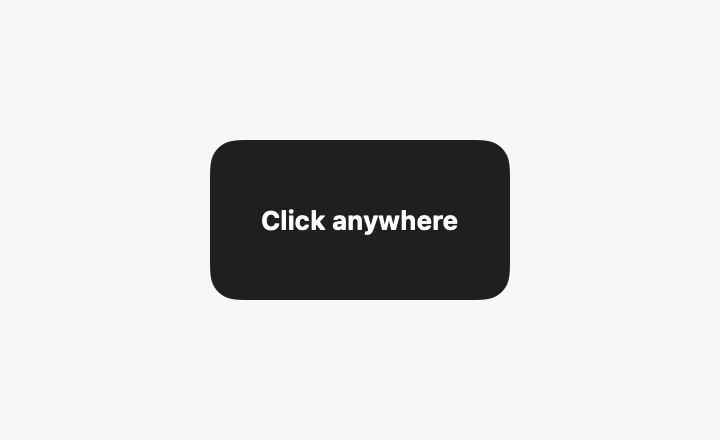<br>
<b>Click Spark</b><br>
<sub>Tap</sub><br>
<code>.clickSpark()</code>
</td>
<td align="center" valign="top" width="33%">
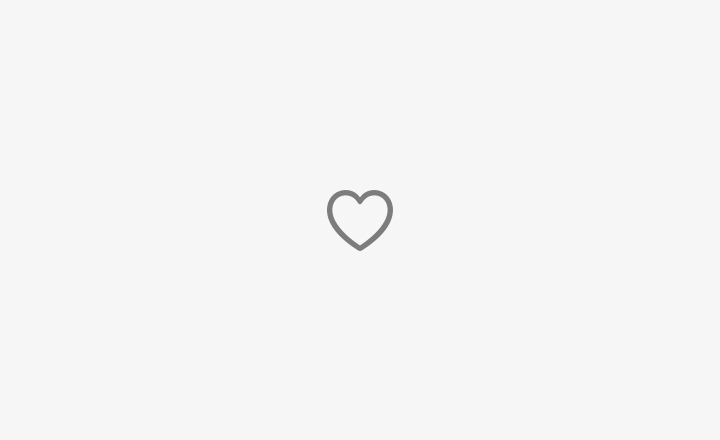<br>
<b>Like Button</b><br>
<sub>Tap</sub><br>
<code>LikeButton(isLiked:)</code>
</td>
<td align="center" valign="top" width="33%">
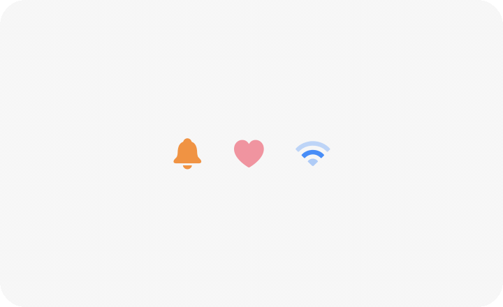<br>
<b>Animated Symbol</b><br>
<sub>Loop</sub><br>
<code>AnimatedSymbol(&quot;…&quot;, style:)</code>
</td>
</tr>
<tr>
<td align="center" valign="top" width="33%">
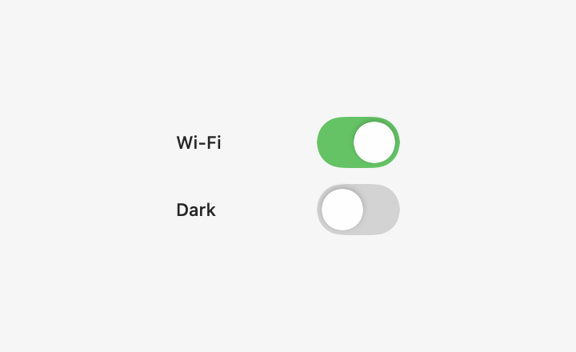<br>
<b>Liquid Toggle</b><br>
<sub>Tap</sub><br>
<code>.toggleStyle(.liquid)</code>
</td>
</tr>
</table>

### Card & Group

<table>
<tr>
<td align="center" valign="top" width="33%">
<br>
<b>Staggered Entrance</b><br>
<sub>Appear</sub><br>
<code>.staggeredAppear(index:)</code>
</td>
<td align="center" valign="top" width="33%">
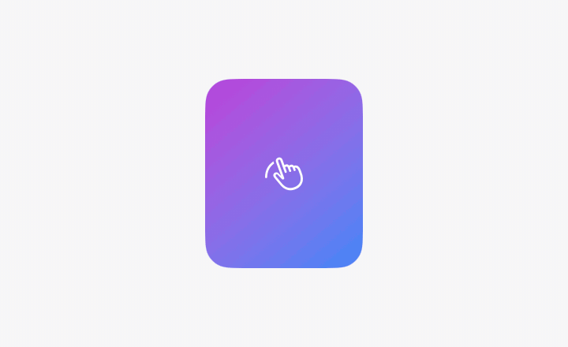<br>
<b>3D Tilt</b><br>
<sub>Drag</sub><br>
<code>.tiltOnDrag()</code>
</td>
<td align="center" valign="top" width="33%">
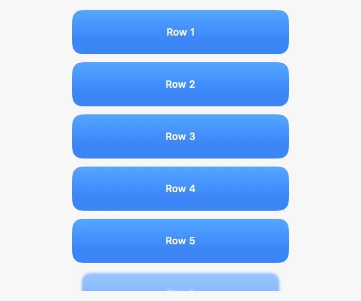<br>
<b>Scroll Reveal</b><br>
<sub>Scroll</sub><br>
<code>.scrollReveal()</code>
</td>
</tr>
<tr>
<td align="center" valign="top" width="33%">
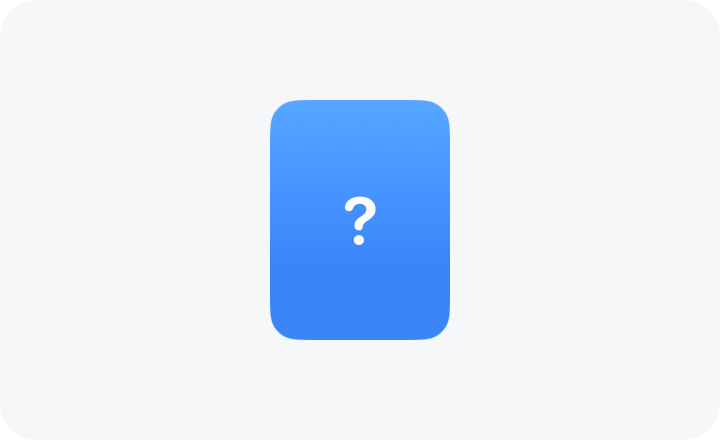<br>
<b>Flip Card</b><br>
<sub>Tap / Value change</sub><br>
<code>FlipCard(isFlipped:) { } back: { }</code>
</td>
<td align="center" valign="top" width="33%">
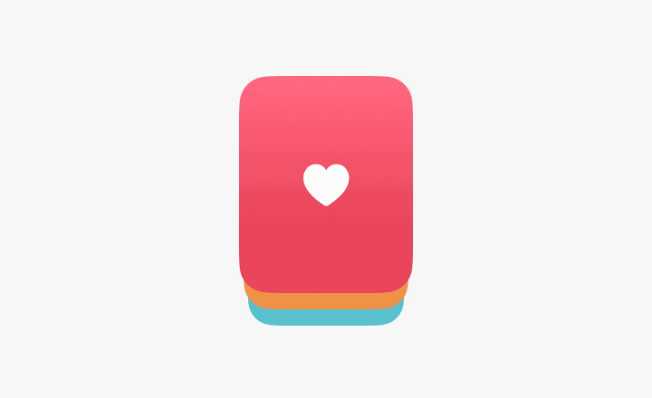<br>
<b>Swipe Card Stack</b><br>
<sub>Drag</sub><br>
<code>SwipeCardStack(items) { item in }</code>
</td>
<td align="center" valign="top" width="33%">
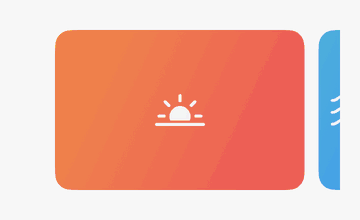<br>
<b>Parallax Carousel</b><br>
<sub>Scroll</sub><br>
<code>ParallaxCarousel(items) { item in }</code>
</td>
</tr>
<tr>
<td align="center" valign="top" width="33%">
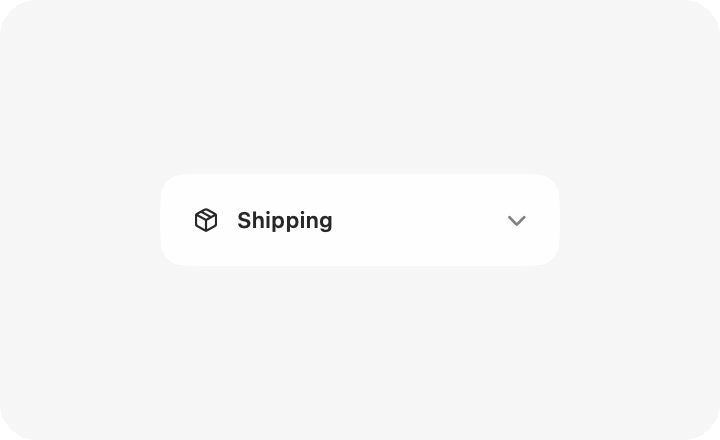<br>
<b>Expandable Card</b><br>
<sub>Tap</sub><br>
<code>ExpandableCard(isExpanded:) { } detail: { }</code>
</td>
<td align="center" valign="top" width="33%">
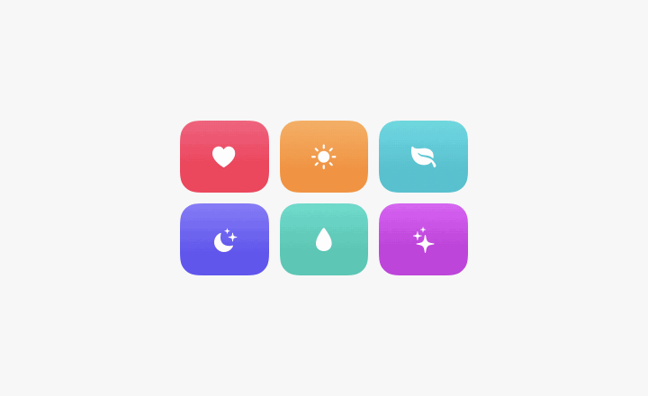<br>
<b>Hero Expand</b><br>
<sub>Tap</sub><br>
<code>HeroGrid(items) { thumbnail } detail: { }</code>
</td>
<td align="center" valign="top" width="33%">
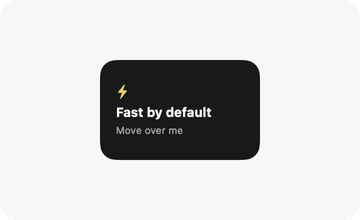<br>
<b>Spotlight Card</b><br>
<sub>Hover / Drag</sub><br>
<code>.spotlight()</code>
</td>
</tr>
<tr>
<td align="center" valign="top" width="33%">
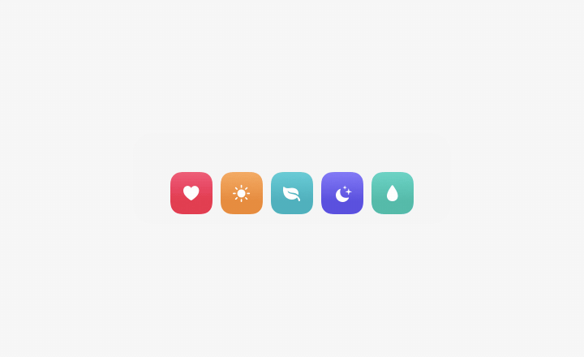<br>
<b>Magnifying Dock</b><br>
<sub>Hover / Drag</sub><br>
<code>MagnifyingDock(items) { item in }</code>
</td>
<td align="center" valign="top" width="33%">
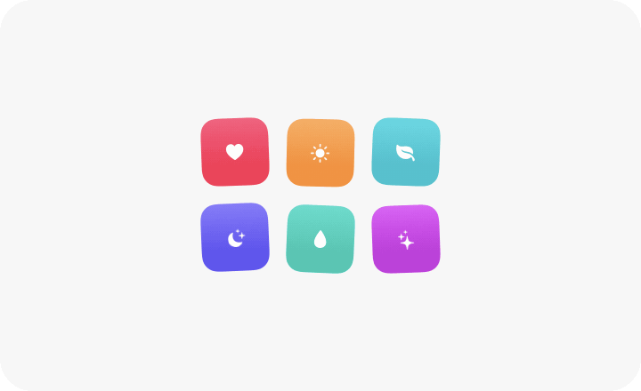<br>
<b>Jiggle</b><br>
<sub>Loop / Value change</sub><br>
<code>.jiggle(isActive:)</code>
</td>
<td align="center" valign="top" width="33%">
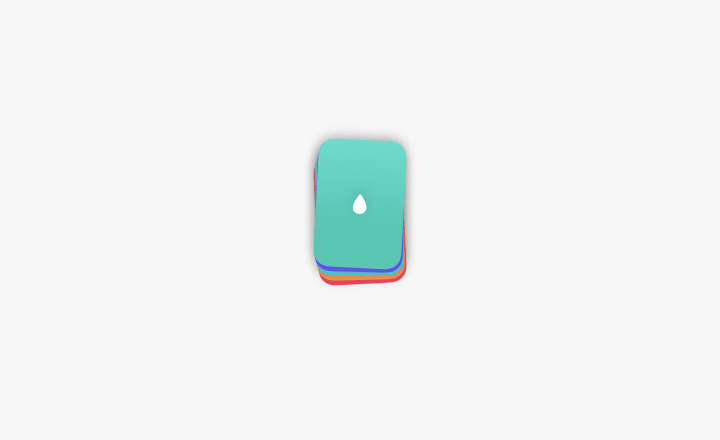<br>
<b>Fan Stack</b><br>
<sub>Tap / Value change</sub><br>
<code>FanStack(items, isSpread:) { item in }</code>
</td>
</tr>
</table>

### Shape

<table>
<tr>
<td align="center" valign="top" width="33%">
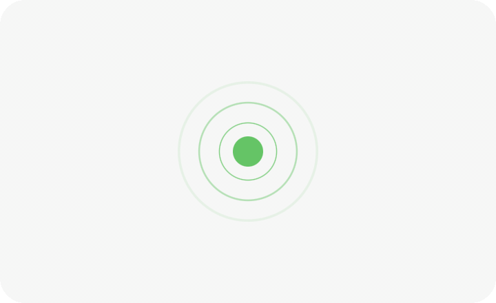<br>
<b>Pulse Rings</b><br>
<sub>Loop</sub><br>
<code>PulseRings()</code>
</td>
<td align="center" valign="top" width="33%">
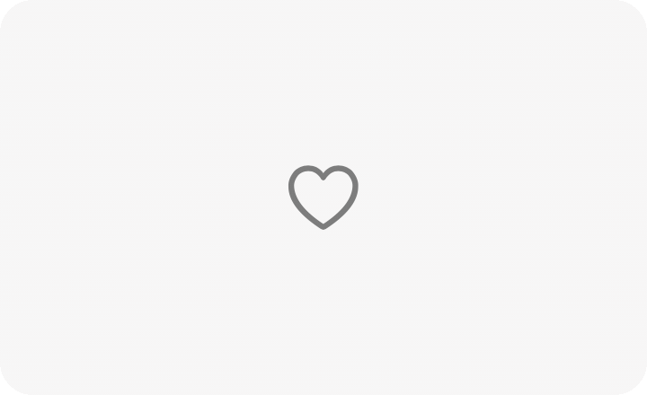<br>
<b>Like Burst</b><br>
<sub>Tap / Value change</sub><br>
<code>.burst(trigger:)</code>
</td>
<td align="center" valign="top" width="33%">
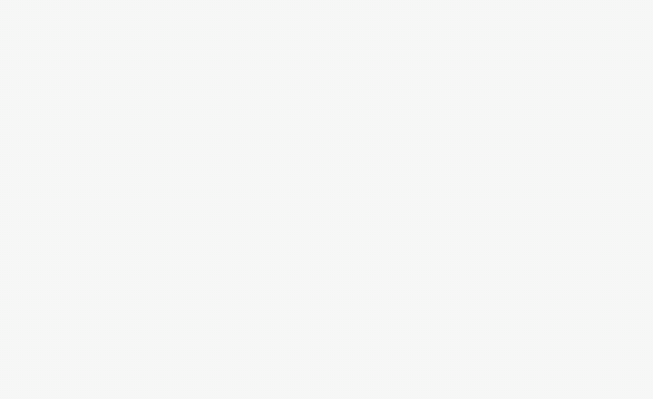<br>
<b>Checkmark Draw</b><br>
<sub>Value change</sub><br>
<code>AnimatedCheckmark(isChecked:)</code>
</td>
</tr>
<tr>
<td align="center" valign="top" width="33%">
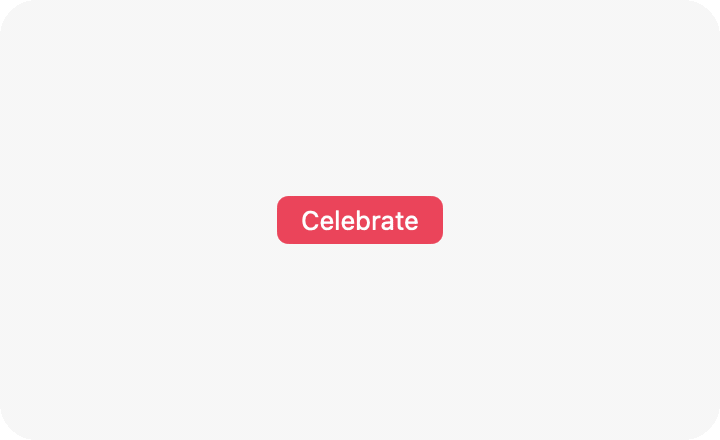<br>
<b>Confetti</b><br>
<sub>Tap / Value change</sub><br>
<code>.confetti(trigger:)</code>
</td>
<td align="center" valign="top" width="33%">
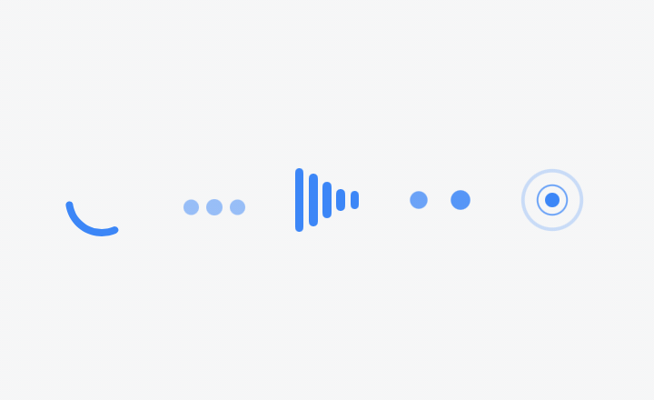<br>
<b>Loaders</b><br>
<sub>Loop</sub><br>
<code>MotionLoader(.spinner)</code>
</td>
<td align="center" valign="top" width="33%">
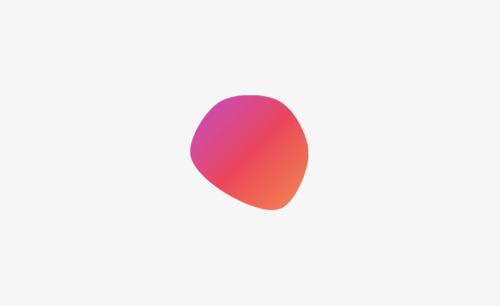<br>
<b>Morphing Blob</b><br>
<sub>Loop</sub><br>
<code>MorphingBlob()</code>
</td>
</tr>
<tr>
<td align="center" valign="top" width="33%">
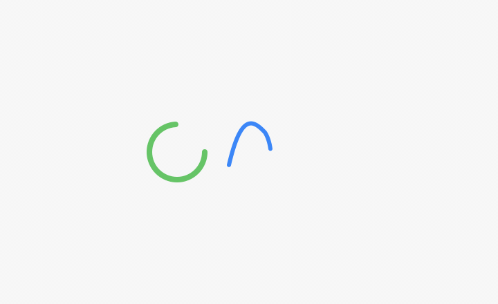<br>
<b>Draw On</b><br>
<sub>Appear / Value change</sub><br>
<code>Shape.drawOn()</code>
</td>
<td align="center" valign="top" width="33%">
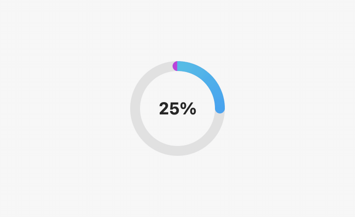<br>
<b>Progress Ring</b><br>
<sub>Value change</sub><br>
<code>ProgressRing(progress:)</code>
</td>
<td align="center" valign="top" width="33%">
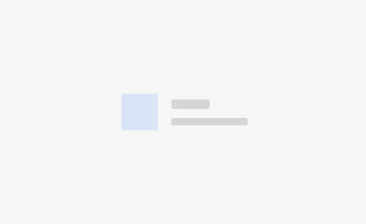<br>
<b>Skeleton</b><br>
<sub>Loop / Value change</sub><br>
<code>.skeleton(isLoading:)</code>
</td>
</tr>
<tr>
<td align="center" valign="top" width="33%">
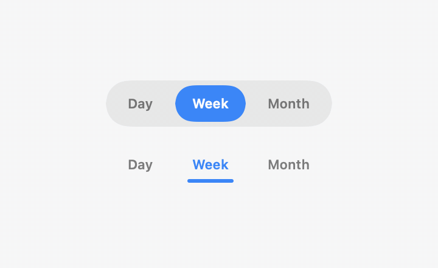<br>
<b>Sliding Tabs</b><br>
<sub>Tap</sub><br>
<code>SlidingTabs([…], selection:)</code>
</td>
</tr>
</table>

### Background

<table>
<tr>
<td align="center" valign="top" width="33%">
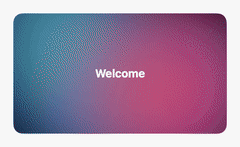<br>
<b>Aurora</b><br>
<sub>Loop</sub><br>
<code>AuroraBackground()</code>
</td>
<td align="center" valign="top" width="33%">
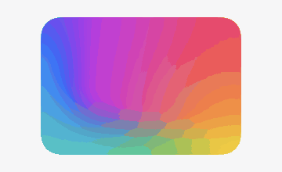<br>
<b>Mesh Gradient</b><br>
<sub>Loop · iOS 18+</sub><br>
<code>AnimatedMeshGradient()</code>
</td>
<td align="center" valign="top" width="33%">
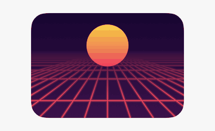<br>
<b>Retro Grid</b><br>
<sub>Loop</sub><br>
<code>RetroGrid()</code>
</td>
</tr>
<tr>
<td align="center" valign="top" width="33%">
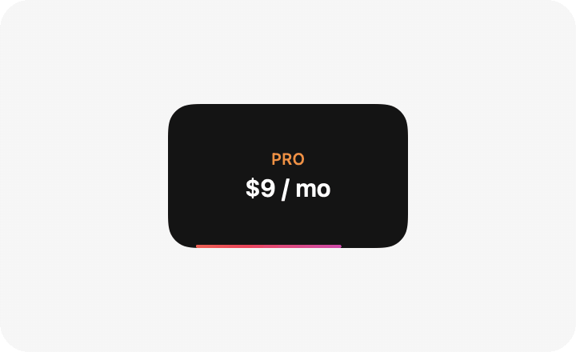<br>
<b>Border Beam</b><br>
<sub>Loop</sub><br>
<code>.borderBeam()</code>
</td>
<td align="center" valign="top" width="33%">
<br>
<b>Waves</b><br>
<sub>Loop</sub><br>
<code>WaveBackground()</code>
</td>
<td align="center" valign="top" width="33%">
<br>
<b>Film Grain</b><br>
<sub>Loop</sub><br>
<code>.grain()</code>
</td>
</tr>
<tr>
<td align="center" valign="top" width="33%">
<br>
<b>Flashlight</b><br>
<sub>Hover / Drag</sub><br>
<code>.flashlight()</code>
</td>
</tr>
</table>

### Number

<table>
<tr>
<td align="center" valign="top" width="33%">
<br>
<b>Rolling Number</b><br>
<sub>Value change</sub><br>
<code>RollingNumber(value:)</code>
</td>
</tr>
</table>

### Particle & 3D

<table>
<tr>
<td align="center" valign="top" width="33%">
<br>
<b>Particle Field</b><br>
<sub>Loop</sub><br>
<code>ParticleField()</code>
</td>
<td align="center" valign="top" width="33%">
<br>
<b>Starfield</b><br>
<sub>Loop</sub><br>
<code>Starfield()</code>
</td>
<td align="center" valign="top" width="33%">
<br>
<b>Cover Flow</b><br>
<sub>Scroll</sub><br>
<code>CoverFlow(items) { item in }</code>
</td>
</tr>
<tr>
<td align="center" valign="top" width="33%">
<br>
<b>Float 3D</b><br>
<sub>Loop</sub><br>
<code>.float3D()</code>
</td>
<td align="center" valign="top" width="33%">
<br>
<b>Fireworks</b><br>
<sub>Loop</sub><br>
<code>Fireworks()</code>
</td>
<td align="center" valign="top" width="33%">
<br>
<b>Snowfall &amp; Rain</b><br>
<sub>Loop</sub><br>
<code>Snowfall(.snow / .rain)</code>
</td>
</tr>
<tr>
<td align="center" valign="top" width="33%">
<br>
<b>Floating Reactions</b><br>
<sub>Tap / Value change</sub><br>
<code>.floatingReactions(trigger:)</code>
</td>
<td align="center" valign="top" width="33%">
<br>
<b>Warp Tunnel</b><br>
<sub>Loop</sub><br>
<code>WarpTunnel()</code>
</td>
<td align="center" valign="top" width="33%">
<br>
<b>Holographic Card</b><br>
<sub>Hover / Drag</sub><br>
<code>.holographic()</code>
</td>
</tr>
</table>

### Transition

<table>
<tr>
<td align="center" valign="top" width="33%">
<br>
<b>Iris</b><br>
<sub>Appear</sub><br>
<code>.transition(.iris)</code>
</td>
<td align="center" valign="top" width="33%">
<br>
<b>Blinds</b><br>
<sub>Appear</sub><br>
<code>.transition(.blinds)</code>
</td>
<td align="center" valign="top" width="33%">
<br>
<b>Clock Wipe</b><br>
<sub>Appear</sub><br>
<code>.transition(.clockWipe)</code>
</td>
</tr>
<tr>
<td align="center" valign="top" width="33%">
<br>
<b>Pixel Dissolve</b><br>
<sub>Appear</sub><br>
<code>.transition(.dissolve)</code>
</td>
<td align="center" valign="top" width="33%">
<br>
<b>Poof</b><br>
<sub>Appear</sub><br>
<code>.transition(.poof)</code>
</td>
<td align="center" valign="top" width="33%">
<br>
<b>Swoosh</b><br>
<sub>Appear</sub><br>
<code>.transition(.swoosh)</code>
</td>
</tr>
<tr>
<td align="center" valign="top" width="33%">
<br>
<b>Film Exposure</b><br>
<sub>Appear</sub><br>
<code>.transition(.filmExposure)</code>
</td>
</tr>
</table>
<!-- effects:end -->

The previews are recorded from the gallery demos with `Scripts/record-readme-gifs.sh` (macOS, needs ffmpeg). It renders off-screen, so you can keep working while it runs.

## Use it with AI coding tools

The library is built to be picked up by AI assistants, so "add a hold-to-delete button" turns into one line of `MotionLibrary` instead of 80 lines of hand-tuned animation.

| Format | For | How |
|---|---|---|
| [`llms.txt`](llms.txt) / [`llms-full.txt`](llms-full.txt) | Any assistant | Point it at the raw URL, or paste the file. `llms-full.txt` has every effect's usage, technique and source. |
| [Agent Skill](skills/swiftui-motion) | Claude Code and other skill-aware agents | Copy `skills/swiftui-motion` into `~/.claude/skills/` or your project's `.claude/skills/`. |
| [Cursor rule](.cursor/rules/swiftui-motion.mdc) | Cursor | Copy it into your project's `.cursor/rules/`. |
| [MCP server](mcp) | Claude Code, Claude Desktop, Cursor, VS Code… | `claude mcp add swiftui-motion -- node /path/to/mcp/server.mjs`. Tools: `list_motion_effects`, `get_motion_effect`. |
| [`motion-catalog.json`](Docs/motion-catalog.json) | Your own tools | Every effect as structured data. |

All of these are generated from the catalog by `Scripts/generate-docs.sh`, and CI fails if they fall out of date.

## Requirements

iOS 17+, macOS 14+, visionOS 1+, Xcode 15+. A few effects need iOS 18 (macOS 15, visionOS 2); they are marked in the grid and `@available` in code.

## Installation

Swift Package Manager: **File → Add Package Dependencies…** and enter this repository's URL, or:

```swift
.package(url: "https://github.com/BigTsung/SwiftUI-Motion-Library", branch: "main")
```

```swift
.product(name: "MotionLibrary", package: "SwiftUI-Motion-Library"),   // the effects
.product(name: "MotionGallery", package: "SwiftUI-Motion-Library"),   // optional browser UI
```

## Quick start

```swift
import MotionLibrary

struct LoginView: View {
    @State private var attempts = 0
    @State private var password = ""

    var body: some View {
        VStack(spacing: 24) {
            TypewriterText("Welcome back")
                .font(.largeTitle.bold())

            SecureField("Password", text: $password)
                .textFieldStyle(.roundedBorder)
                .shake(trigger: attempts)

            Button("Sign in") { attempts += 1 }
                .buttonStyle(.pressable)
        }
        .padding()
        .background(AuroraBackground().ignoresSafeArea())
    }
}
```

## Browse the gallery

- **Fastest:** open `Package.swift` in Xcode, open `Sources/MotionGallery/Views/MotionGalleryView.swift` and use the canvas preview. Every effect file also has its own `#Preview`.
- **In an app:** add the `MotionGallery` product and show `MotionGalleryView()`.

The gallery lets you filter by component and trigger, play with each effect, replay it, and copy the usage code or AI prompt.

## Project layout

```
Sources/
  MotionLibrary/          # the effects (public API, zero dependencies)
    Text/  Button/  Card/  Shape/  Background/  Number/  Particle/  Transition/
  MotionGallery/          # catalog metadata + browser UI
    Model/MotionEffect.swift
    Catalog/MotionCatalog.swift   # one entry per effect: the source of truth
    Catalog/Demos.swift           # demo views
    Views/
Docs/                     # README GIFs + motion-catalog.json (generated)
llms.txt  llms-full.txt   # generated
skills/  .cursor/rules/   # Agent Skill and Cursor rule (generated)
mcp/                      # zero-dependency MCP server
Scripts/
  check-build.sh          # compile without Xcode
  generate-docs.sh        # regenerate everything derived from the catalog
  record-readme-gifs.sh   # record the README GIFs (off-screen)
```

## Contributing

New effects are very welcome. See [CONTRIBUTING.md](CONTRIBUTING.md). Each effect is one source file, one demo view and one catalog entry.

## License

MIT. Use it in commercial apps, no attribution required (but appreciated ⭐).
