<div align="center">

# SwiftUI Motion Library

**可以直接複製使用的 SwiftUI 動態效果，依元件和觸發時機瀏覽。**<br>
每個效果都有即時 Demo、用法程式碼和 AI 提示詞。純 SwiftUI，零依賴。<br>
<sub>🌐 English speakers: see the <a href="README.md">English README</a></sub>

<a href="https://swift.org"></a>   <a href="#授權"></a> <a href="README.md"></a>

🤖 **為 AI 編碼工具而做。** `llms.txt`、Agent Skill、Cursor rule 和 MCP server<br>
都和 Gallery 從同一份 catalog 產生。[看怎麼用 ↓](#請-ai-助理幫你加)<br>
**AI agent 請從 [`llms.txt`](https://raw.githubusercontent.com/BigTsung/SwiftUI-Motion-Library/main/llms.txt) 開始讀**：所有效果、API 和各自需要的檔案都在裡面。

🆕 **2026-11-04 · 新增 27 個效果**：拉繩開關、膠囊展開、Hover Lift、鳥群、墨水軌跡，以及 Genie、沙化消散、玻璃放大鏡等 10 個著色器。[看著色器效果 ↓](#著色器)<br>
🆕 **2026-11-04 · v0.4**：新增 45 個效果，以及選用的 `MotionShaders` product。[看著色器效果 ↓](#著色器)<br>
🆕 **2026-11-04 · 範例 App**：包含 Gallery、捲動效果全螢幕範例和 UI 測試的 iOS App。[打開它 ↓](#方式二clone-下來瀏覽-gallery)

</div>

## ✨ 精選效果

<table>
<tr>
<td width="33%" align="center" valign="top">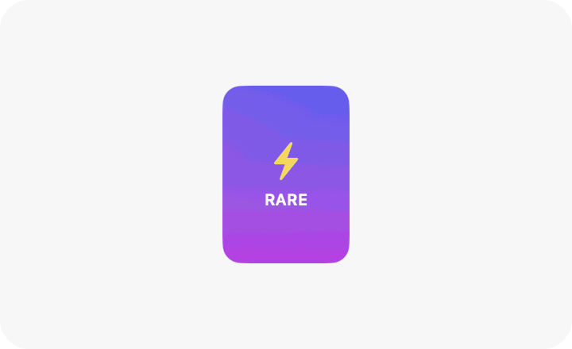<br><a href="https://github.com/BigTsung/SwiftUI-Motion-Library/blob/main/Sources/MotionLibrary/Particle/Holographic.swift"><b>Holographic Card</b></a><br><sub>卡片 · 懸停 / 拖曳</sub><br><code>.holographic()</code></td>
<td width="33%" align="center" valign="top">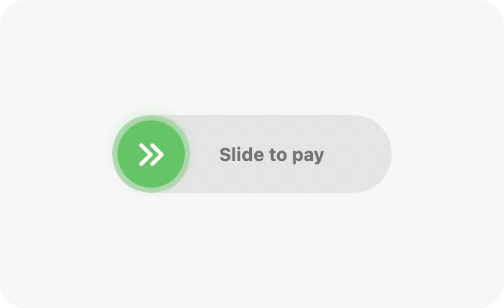<br><a href="https://github.com/BigTsung/SwiftUI-Motion-Library/blob/main/Sources/MotionLibrary/Button/SlideToConfirm.swift"><b>Slide to Confirm</b></a><br><sub>按鈕 · 拖曳</sub><br><code>SlideToConfirm(_:action:)</code></td>
<td width="33%" align="center" valign="top">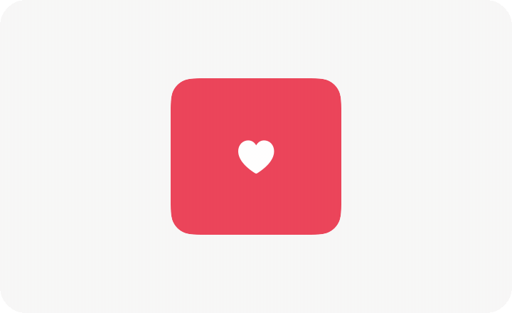<br><a href="https://github.com/BigTsung/SwiftUI-Motion-Library/blob/main/Sources/MotionLibrary/Transition/LiquidSwipe.swift"><b>Liquid Swipe</b></a><br><sub>轉場 · 數值改變</sub><br><code>.transition(.liquidSwipe)</code></td>
</tr>
<tr>
<td width="33%" align="center" valign="top">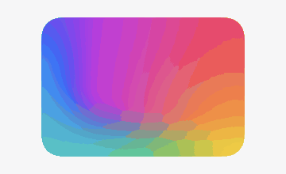<br><a href="https://github.com/BigTsung/SwiftUI-Motion-Library/blob/main/Sources/MotionLibrary/Background/AnimatedMeshGradient.swift"><b>Mesh Gradient</b></a><br><sub>背景 · 循環 · iOS 18+</sub><br><code>AnimatedMeshGradient()</code></td>
<td width="33%" align="center" valign="top">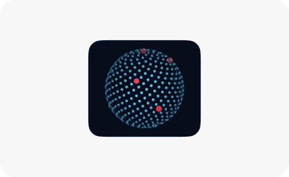<br><a href="https://github.com/BigTsung/SwiftUI-Motion-Library/blob/main/Sources/MotionLibrary/Particle/DotGlobe.swift"><b>Dot Globe</b></a><br><sub>粒子與 3D · 循環</sub><br><code>DotGlobe()</code></td>
<td width="33%" align="center" valign="top">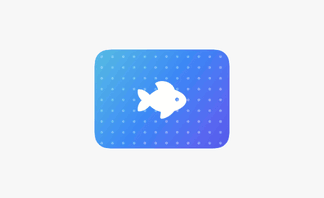<br><a href="https://github.com/BigTsung/SwiftUI-Motion-Library/blob/main/Sources/MotionShaders/WaterRipple.swift"><b>Water Ripple</b></a><br><sub>著色器 · 點擊 / 數值改變</sub><br><code>.waterRippleOnTap()</code></td>
</tr>
</table>

<div align="center">

每張預覽都是從 Gallery 本身的 Demo 錄製的。<br>
[**所有效果 ↓**](#效果) · [**開始使用 ↓**](#使用方式) · [**參與貢獻 ↓**](#參與貢獻)

</div>

## 👋 為什麼做這個

網頁前端有很完整的動態效果收藏站，依照「動的是什麼」和「什麼時候動」分類。SwiftUI 雖然有不少很棒的單一效果 repo 和幾個專注的套件，卻一直沒有一個地方可以用 **元件 × 觸發時機** 瀏覽效果、直接試玩、把程式碼帶走。這個 repo 想成為那個地方。

每個效果都包含：

- 🧩 **可重用的 API**：`View`、`ViewModifier` 或 `ButtonStyle`，沒有任何外部依賴。
- ▶️ **即時 Demo**：在內建的 Gallery 裡可以直接操作。
- 📋 **用法程式碼**：可以直接複製。
- 🤖 **AI 提示詞**：描述外觀和實作手法，貼給 Claude、ChatGPT 或 Copilot 就能改出自己的版本。
- ♿️ **支援減少動態效果（Reduce Motion）**：會循環或大幅移動的效果，都會自動改成淡入淡出或靜止狀態。

## 使用方式

加入套件後，一行程式碼套用效果，或讓 AI 助理幫你挑。

### 方式一：Swift Package Manager（推薦）

在 Xcode 選 **File → Add Package Dependencies…**，輸入本 repo 的網址；或在 `Package.swift` 加入：

```swift
.package(url: "https://github.com/BigTsung/SwiftUI-Motion-Library", from: "0.4.0")
```

```swift
.product(name: "MotionLibrary", package: "SwiftUI-Motion-Library"),   // 效果本體
.product(name: "MotionShaders", package: "SwiftUI-Motion-Library"),   // 選用：Metal 著色器效果
.product(name: "MotionGallery", package: "SwiftUI-Motion-Library"),   // 選用：瀏覽介面
```

### 方式二：clone 下來瀏覽 Gallery

- **最快的方式**：用 Xcode 打開 `Package.swift`，開啟 `Sources/MotionGallery/Views/MotionGalleryView.swift`，用 Canvas 預覽。每個效果的原始碼檔案也都有自己的 `#Preview`。
- **在 App 裡**：加入 `MotionGallery` product，顯示 `MotionGalleryView()`。
- **範例 App**：打開 `Examples/MotionLibraryDemo/MotionLibraryDemo.xcodeproj`，在模擬器或實機上執行（要跑在實機上，請在 Signing 選你的 Team）。裡面有完整的 Gallery、捲動效果的全螢幕範例（堆疊卡片、縮小標頭、彈性標頭、閱讀進度），以及用手指實際捲動它們的 UI 測試。

Gallery 可以依元件和觸發時機篩選，操作、重播每個效果，並複製用法程式碼或 AI 提示詞。

### 方式三：只複製需要的檔案

完全不加依賴：點下方效果的名稱打開原始碼檔，整個複製即可。預覽下方的 API 就是呼叫方式，[`llms-full.txt`](llms-full.txt) 裡有每個效果完整的用法範例。少數效果共用小型 helper（例如 `Support/Haptics.swift`），它們的格子裡會列出並連結所有要一起複製的檔案。每個效果只靠這些檔案就能編譯，由 `Scripts/check-standalone.sh` 驗證。

### 接著用一行程式碼套用

```swift
import MotionLibrary

struct LoginView: View {
    @State private var attempts = 0
    @State private var password = ""

    var body: some View {
        VStack(spacing: 24) {
            TypewriterText("Welcome back")
                .font(.largeTitle.bold())

            SecureField("Password", text: $password)
                .textFieldStyle(.roundedBorder)
                .shake(trigger: attempts)

            Button("Sign in") { attempts += 1 }
                .buttonStyle(.pressable)
        }
        .padding()
        .background(AuroraBackground().ignoresSafeArea())
    }
}
```

### 請 AI 助理幫你加

這個 library 就是設計給 AI 助理使用的：跟 AI 說「加一個長按刪除的按鈕」，它會用一行 `MotionLibrary` 完成，而不是手寫 80 行調過的動畫。把下面這段貼給任何能上網的 AI 助理：

```text
請使用 SwiftUI Motion Library（https://github.com/BigTsung/SwiftUI-Motion-Library）。
先讀 https://raw.githubusercontent.com/BigTsung/SwiftUI-Motion-Library/main/llms.txt，再把 <效果名稱> 加到 <你的畫面>。
```

AI 會在裡面找到該效果，加入套件（如果你不想加依賴，就改成複製該效果列出的檔案），再照用法程式碼套用。

| 格式 | 適用 | 使用方式 |
|---|---|---|
| [`llms.txt`](llms.txt) / [`llms-full.txt`](llms-full.txt) | 任何 AI 助理 | 給它 raw 網址，或直接貼上檔案。`llms-full.txt` 包含每個效果的用法、原理和完整原始碼。 |
| [Agent Skill](skills/swiftui-motion) | Claude Code 和其他支援 Skill 的 Agent | 把 `skills/swiftui-motion` 複製到 `~/.claude/skills/` 或專案的 `.claude/skills/`。 |
| [Cursor rule](.cursor/rules/swiftui-motion.mdc) | Cursor | 複製到專案的 `.cursor/rules/`。 |
| [MCP server](mcp) | Claude Code、Claude Desktop、Cursor、VS Code… | `claude mcp add swiftui-motion -- node /path/to/mcp/server.mjs`。提供 `list_motion_effects`、`get_motion_effect` 兩個工具。 |
| [`motion-catalog.json`](Docs/motion-catalog.json) | 你自己的工具 | 所有效果的結構化資料。 |

以上全部由 `Scripts/generate-docs.sh` 從 catalog 自動產生；`Scripts/generate-docs.sh --check` 會檢查是否有檔案過期。

### 開始之前

- iOS 17+、macOS 14+、visionOS 1+、Xcode 15+。
- 少數效果需要 iOS 18（macOS 15、visionOS 2），在下方表格中有標示，程式碼裡也有 `@available`。
- 著色器類效果（水波紋、馬賽克、CRT…）放在獨立的 `MotionShaders` product，因為它們是 Metal 著色器：Xcode 26 之後的 Metal Toolchain 要另外下載（**Settings → Components**）。`MotionLibrary` 本身不需要任何額外元件。Gallery 會同時依賴兩者。

## 效果

效果依元件分類：文字、按鈕、卡片、圖形、背景、數字、粒子與 3D、轉場，以及 Metal 著色器。點效果名稱可以看原始碼。

<!-- effects:start (generated by Scripts/generate-docs.sh; edit MotionCatalog.swift instead) -->
<p align="center">共 <b>145 個效果</b>，分為 9 類</p>

<table align="center">
<tr>
<td align="center" width="25%">
🔤<br>
<a href="#文字"><b>文字</b></a><br>
<sub>20 個效果</sub>
</td>
<td align="center" width="25%">
🔘<br>
<a href="#按鈕"><b>按鈕</b></a><br>
<sub>19 個效果</sub>
</td>
<td align="center" width="25%">
🃏<br>
<a href="#卡片與群組"><b>卡片與群組</b></a><br>
<sub>23 個效果</sub>
</td>
<td align="center" width="25%">
🔷<br>
<a href="#圖形"><b>圖形</b></a><br>
<sub>11 個效果</sub>
</td>
</tr>
<tr>
<td align="center" width="25%">
🌈<br>
<a href="#背景"><b>背景</b></a><br>
<sub>15 個效果</sub>
</td>
<td align="center" width="25%">
🔢<br>
<a href="#數字"><b>數字</b></a><br>
<sub>8 個效果</sub>
</td>
<td align="center" width="25%">
✨<br>
<a href="#粒子與-3d"><b>粒子與 3D</b></a><br>
<sub>19 個效果</sub>
</td>
<td align="center" width="25%">
🎬<br>
<a href="#轉場"><b>轉場</b></a><br>
<sub>14 個效果</sub>
</td>
</tr>
<tr>
<td align="center" width="25%">
🪄<br>
<a href="#著色器"><b>著色器</b></a><br>
<sub>16 個效果</sub>
</td>
</tr>
</table>

### 文字

<table>
<tr>
<td align="center" valign="top" width="33%">
<br>
<a href="https://github.com/BigTsung/SwiftUI-Motion-Library/blob/main/Sources/MotionLibrary/Text/TypewriterText.swift"><b>Typewriter</b></a><br>
<sub>進場 / 數值改變</sub><br>
<code>TypewriterText(&quot;…&quot;)</code>
</td>
<td align="center" valign="top" width="33%">
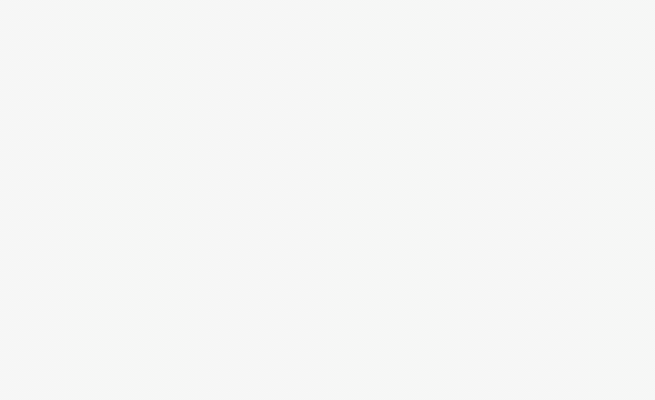<br>
<a href="https://github.com/BigTsung/SwiftUI-Motion-Library/blob/main/Sources/MotionLibrary/Text/ScrambleText.swift"><b>Scramble / Decode</b></a><br>
<sub>進場 / 數值改變</sub><br>
<code>ScrambleText(&quot;…&quot;)</code>
</td>
<td align="center" valign="top" width="33%">
<br>
<a href="https://github.com/BigTsung/SwiftUI-Motion-Library/blob/main/Sources/MotionLibrary/Text/Shimmer.swift"><b>Shimmer</b></a><br>
<sub>循環</sub><br>
<code>.shimmer()</code>
</td>
</tr>
<tr>
<td align="center" valign="top" width="33%">
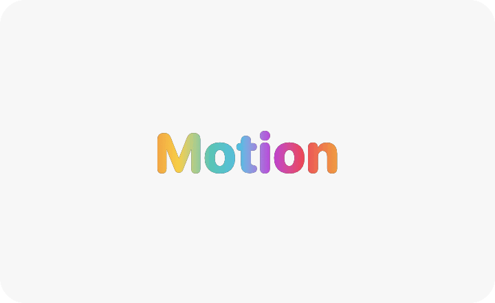<br>
<a href="https://github.com/BigTsung/SwiftUI-Motion-Library/blob/main/Sources/MotionLibrary/Text/GradientSweep.swift"><b>Gradient Sweep</b></a><br>
<sub>循環</sub><br>
<code>.gradientSweep()</code>
</td>
<td align="center" valign="top" width="33%">
<br>
<a href="https://github.com/BigTsung/SwiftUI-Motion-Library/blob/main/Sources/MotionLibrary/Text/BlurInText.swift"><b>Blur-in Words</b></a><br>
<sub>進場 / 數值改變</sub><br>
<code>BlurInText(&quot;…&quot;)</code>
</td>
<td align="center" valign="top" width="33%">
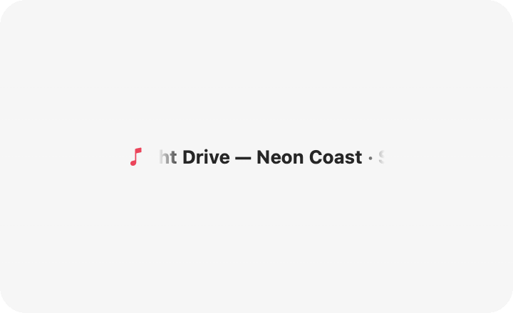<br>
<a href="https://github.com/BigTsung/SwiftUI-Motion-Library/blob/main/Sources/MotionLibrary/Text/MarqueeText.swift"><b>Marquee</b></a><br>
<sub>循環</sub><br>
<code>MarqueeText(&quot;…&quot;)</code>
</td>
</tr>
<tr>
<td align="center" valign="top" width="33%">
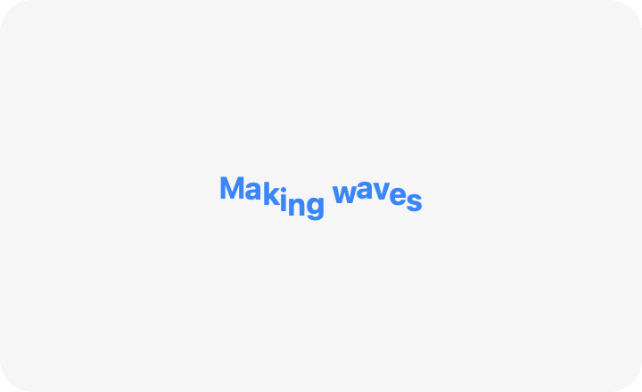<br>
<a href="https://github.com/BigTsung/SwiftUI-Motion-Library/blob/main/Sources/MotionLibrary/Text/WaveText.swift"><b>Wave Text</b></a><br>
<sub>循環 · iOS 18+</sub><br>
<code>WaveText(&quot;…&quot;)</code>
</td>
<td align="center" valign="top" width="33%">
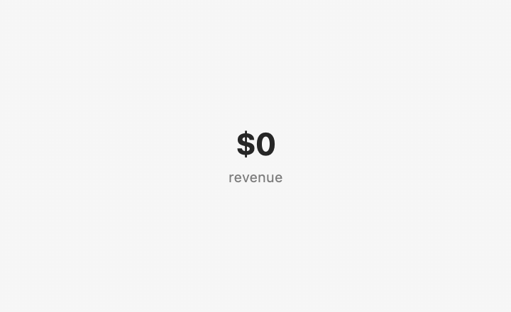<br>
<a href="https://github.com/BigTsung/SwiftUI-Motion-Library/blob/main/Sources/MotionLibrary/Text/CountUpText.swift"><b>Count Up</b></a><br>
<sub>進場 / 數值改變</sub><br>
<code>CountUpText(value: …)</code>
</td>
<td align="center" valign="top" width="33%">
<br>
<a href="https://github.com/BigTsung/SwiftUI-Motion-Library/blob/main/Sources/MotionLibrary/Text/SplitText.swift"><b>Split Text</b></a><br>
<sub>進場 / 數值改變 · iOS 18+</sub><br>
<code>SplitText(&quot;…&quot;)</code>
</td>
</tr>
<tr>
<td align="center" valign="top" width="33%">
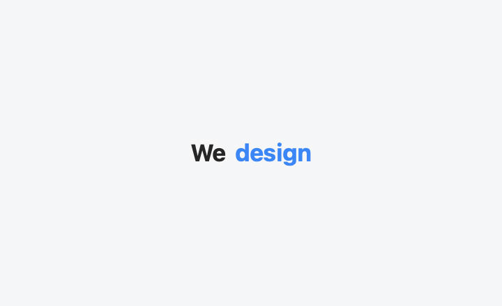<br>
<a href="https://github.com/BigTsung/SwiftUI-Motion-Library/blob/main/Sources/MotionLibrary/Text/RotatingText.swift"><b>Rotating Text</b></a><br>
<sub>循環</sub><br>
<code>RotatingText([…])</code>
</td>
<td align="center" valign="top" width="33%">
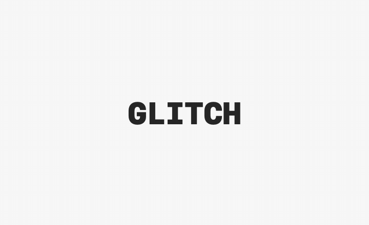<br>
<a href="https://github.com/BigTsung/SwiftUI-Motion-Library/blob/main/Sources/MotionLibrary/Text/Glitch.swift"><b>Glitch</b></a><br>
<sub>循環</sub><br>
<code>.glitch()</code>
</td>
<td align="center" valign="top" width="33%">
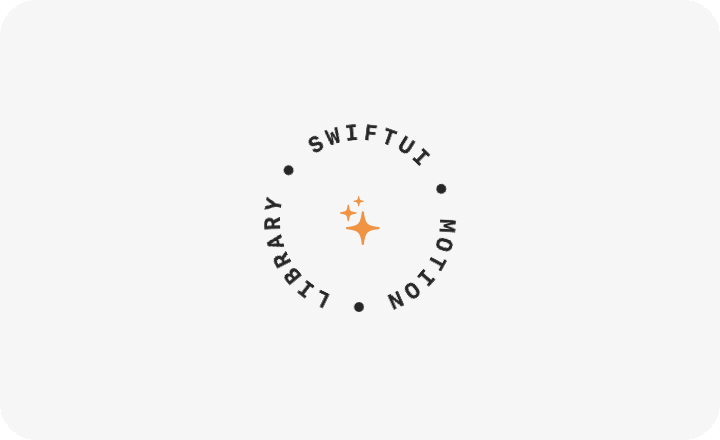<br>
<a href="https://github.com/BigTsung/SwiftUI-Motion-Library/blob/main/Sources/MotionLibrary/Text/CircularText.swift"><b>Circular Text</b></a><br>
<sub>循環</sub><br>
<code>CircularText(&quot;…&quot;)</code>
</td>
</tr>
<tr>
<td align="center" valign="top" width="33%">
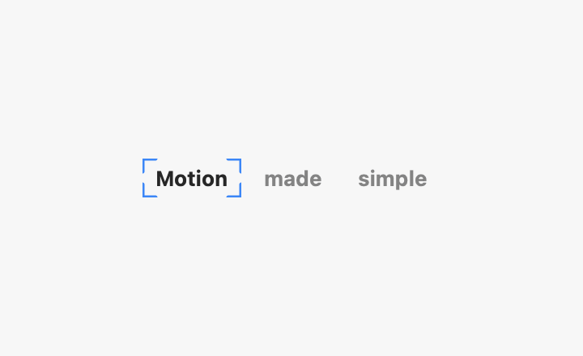<br>
<a href="https://github.com/BigTsung/SwiftUI-Motion-Library/blob/main/Sources/MotionLibrary/Text/FocusText.swift"><b>Focus Text</b></a><br>
<sub>循環</sub><br>
<code>FocusText(&quot;…&quot;)</code>
</td>
<td align="center" valign="top" width="33%">
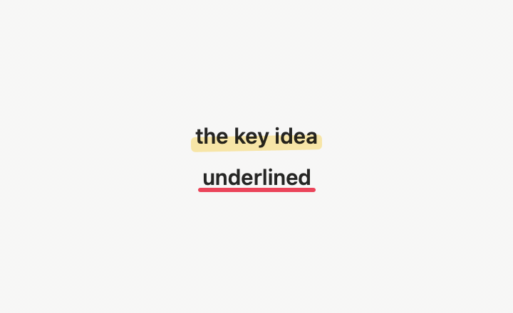<br>
<a href="https://github.com/BigTsung/SwiftUI-Motion-Library/blob/main/Sources/MotionLibrary/Text/Highlighter.swift"><b>Highlighter</b></a><br>
<sub>進場 / 數值改變</sub><br>
<code>.highlighter()</code>
</td>
<td align="center" valign="top" width="33%">
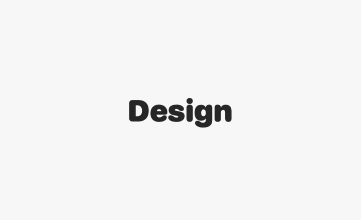<br>
<a href="https://github.com/BigTsung/SwiftUI-Motion-Library/blob/main/Sources/MotionLibrary/Text/MorphingText.swift"><b>Morphing Text</b></a><br>
<sub>循環</sub><br>
<code>MorphingText([…])</code>
</td>
</tr>
<tr>
<td align="center" valign="top" width="33%">
<br>
<a href="https://github.com/BigTsung/SwiftUI-Motion-Library/blob/main/Sources/MotionLibrary/Text/NeonFlicker.swift"><b>Neon Flicker</b></a><br>
<sub>循環</sub><br>
<code>.neon(color:flicker:)</code>
</td>
<td align="center" valign="top" width="33%">
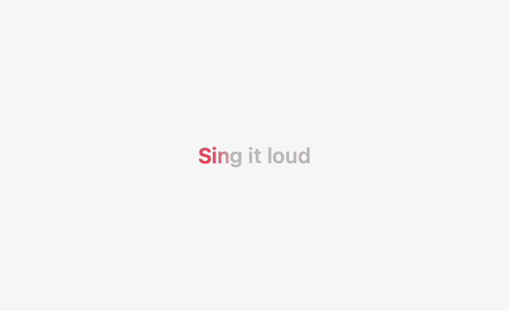<br>
<a href="https://github.com/BigTsung/SwiftUI-Motion-Library/blob/main/Sources/MotionLibrary/Text/KaraokeText.swift"><b>Karaoke Text</b></a><br>
<sub>數值改變 / 捲動</sub><br>
<code>KaraokeText(_:progress:)</code>
</td>
<td align="center" valign="top" width="33%">
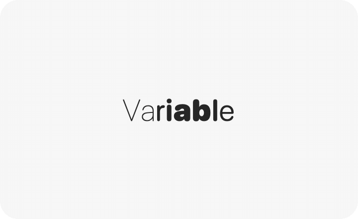<br>
<a href="https://github.com/BigTsung/SwiftUI-Motion-Library/blob/main/Sources/MotionLibrary/Text/WeightWaveText.swift"><b>Weight Wave</b></a><br>
<sub>循環</sub><br>
<code>WeightWaveText(_:)</code>
</td>
</tr>
<tr>
<td align="center" valign="top" width="33%">
<br>
<a href="https://github.com/BigTsung/SwiftUI-Motion-Library/blob/main/Sources/MotionLibrary/Text/ExplodingText.swift"><b>Exploding Text</b></a><br>
<sub>數值改變 / 點擊 · iOS 18+</sub><br>
<code>ExplodingText(_:isExploded:)</code>
</td>
<td align="center" valign="top" width="33%">
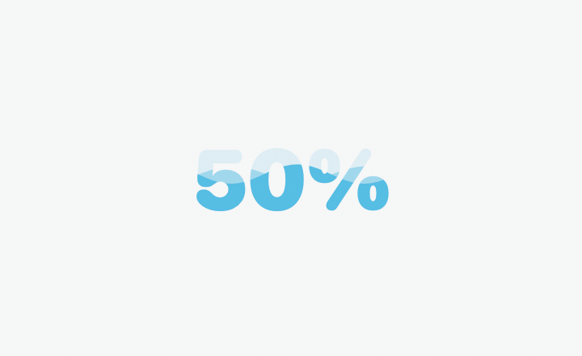<br>
<a href="https://github.com/BigTsung/SwiftUI-Motion-Library/blob/main/Sources/MotionLibrary/Text/LiquidFillText.swift"><b>Liquid Fill Text</b></a><br>
<sub>數值改變 / 循環</sub><br>
<code>LiquidFillText(_:progress:)</code>
</td>
</tr>
</table>

### 按鈕

<table>
<tr>
<td align="center" valign="top" width="33%">
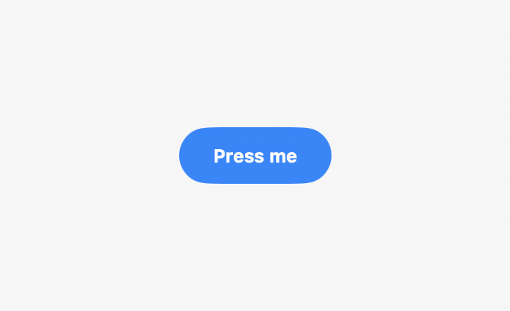<br>
<a href="https://github.com/BigTsung/SwiftUI-Motion-Library/blob/main/Sources/MotionLibrary/Button/PressableButtonStyle.swift"><b>Pressable</b></a><br>
<sub>按壓</sub><br>
<code>.buttonStyle(.pressable)</code><br><sub>直接複製檔案時，還需要 <a href="https://github.com/BigTsung/SwiftUI-Motion-Library/blob/main/Sources/MotionLibrary/Support/Haptics.swift">Haptics.swift</a></sub>
</td>
<td align="center" valign="top" width="33%">
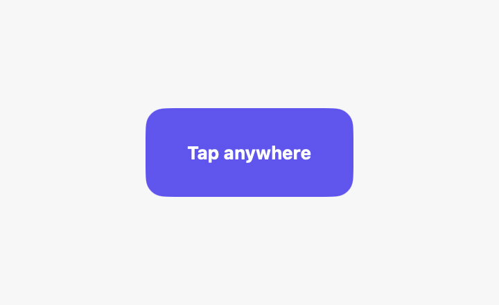<br>
<a href="https://github.com/BigTsung/SwiftUI-Motion-Library/blob/main/Sources/MotionLibrary/Button/Ripple.swift"><b>Tap Ripple</b></a><br>
<sub>點擊</sub><br>
<code>.ripple()</code>
</td>
<td align="center" valign="top" width="33%">
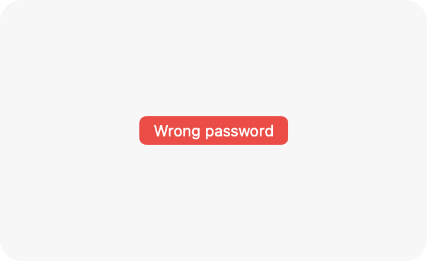<br>
<a href="https://github.com/BigTsung/SwiftUI-Motion-Library/blob/main/Sources/MotionLibrary/Button/Shake.swift"><b>Error Shake</b></a><br>
<sub>數值改變</sub><br>
<code>.shake(trigger:)</code>
</td>
</tr>
<tr>
<td align="center" valign="top" width="33%">
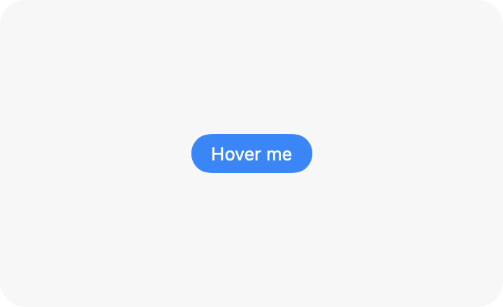<br>
<a href="https://github.com/BigTsung/SwiftUI-Motion-Library/blob/main/Sources/MotionLibrary/Button/Magnetic.swift"><b>Magnetic Button</b></a><br>
<sub>懸停 / 拖曳</sub><br>
<code>.magnetic()</code>
</td>
<td align="center" valign="top" width="33%">
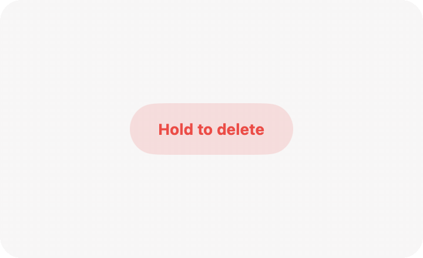<br>
<a href="https://github.com/BigTsung/SwiftUI-Motion-Library/blob/main/Sources/MotionLibrary/Button/HoldToConfirmButton.swift"><b>Hold to Confirm</b></a><br>
<sub>按壓</sub><br>
<code>HoldToConfirmButton(&quot;…&quot;) { }</code><br><sub>直接複製檔案時，還需要 <a href="https://github.com/BigTsung/SwiftUI-Motion-Library/blob/main/Sources/MotionLibrary/Support/Haptics.swift">Haptics.swift</a></sub>
</td>
<td align="center" valign="top" width="33%">
<br>
<a href="https://github.com/BigTsung/SwiftUI-Motion-Library/blob/main/Sources/MotionLibrary/Button/StatusButton.swift"><b>Loading → Success</b></a><br>
<sub>點擊 / 數值改變</sub><br>
<code>StatusButton(&quot;…&quot;, status:) { }</code><br><sub>直接複製檔案時，還需要 <a href="https://github.com/BigTsung/SwiftUI-Motion-Library/blob/main/Sources/MotionLibrary/Support/CheckmarkShape.swift">CheckmarkShape.swift</a>, <a href="https://github.com/BigTsung/SwiftUI-Motion-Library/blob/main/Sources/MotionLibrary/Support/Haptics.swift">Haptics.swift</a></sub>
</td>
</tr>
<tr>
<td align="center" valign="top" width="33%">
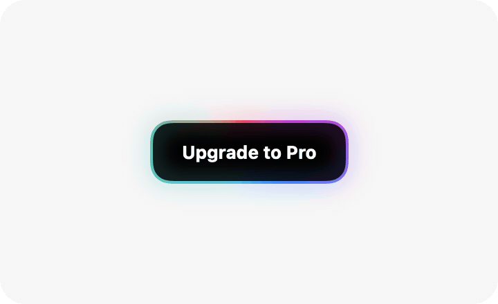<br>
<a href="https://github.com/BigTsung/SwiftUI-Motion-Library/blob/main/Sources/MotionLibrary/Button/GlowBorder.swift"><b>Glow Border</b></a><br>
<sub>循環</sub><br>
<code>.glowBorder()</code>
</td>
<td align="center" valign="top" width="33%">
<br>
<a href="https://github.com/BigTsung/SwiftUI-Motion-Library/blob/main/Sources/MotionLibrary/Button/Shine.swift"><b>Shine</b></a><br>
<sub>數值改變 / 循環</sub><br>
<code>.shine(every:) / .shine(trigger:)</code>
</td>
<td align="center" valign="top" width="33%">
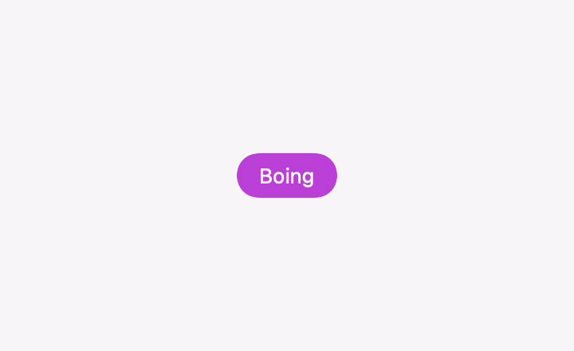<br>
<a href="https://github.com/BigTsung/SwiftUI-Motion-Library/blob/main/Sources/MotionLibrary/Button/Jelly.swift"><b>Jelly</b></a><br>
<sub>點擊 / 數值改變</sub><br>
<code>.jelly(trigger:)</code>
</td>
</tr>
<tr>
<td align="center" valign="top" width="33%">
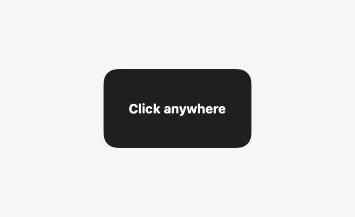<br>
<a href="https://github.com/BigTsung/SwiftUI-Motion-Library/blob/main/Sources/MotionLibrary/Button/ClickSpark.swift"><b>Click Spark</b></a><br>
<sub>點擊</sub><br>
<code>.clickSpark()</code>
</td>
<td align="center" valign="top" width="33%">
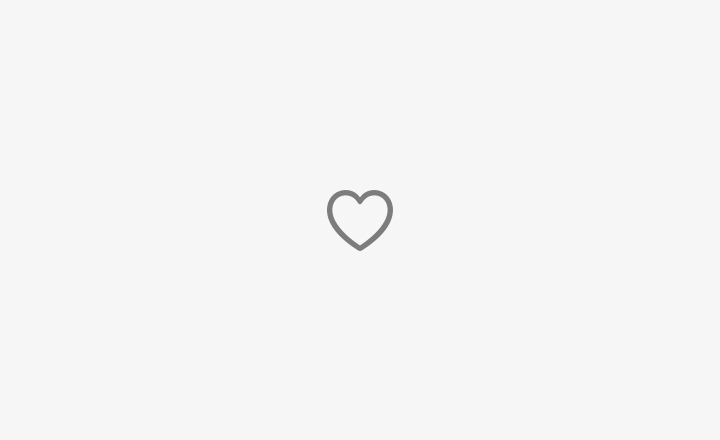<br>
<a href="https://github.com/BigTsung/SwiftUI-Motion-Library/blob/main/Sources/MotionLibrary/Button/LikeButton.swift"><b>Like Button</b></a><br>
<sub>點擊</sub><br>
<code>LikeButton(isLiked:)</code><br><sub>直接複製檔案時，還需要 <a href="https://github.com/BigTsung/SwiftUI-Motion-Library/blob/main/Sources/MotionLibrary/Support/Haptics.swift">Haptics.swift</a></sub>
</td>
<td align="center" valign="top" width="33%">
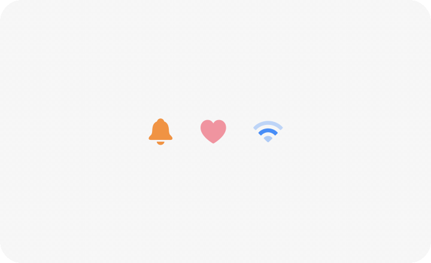<br>
<a href="https://github.com/BigTsung/SwiftUI-Motion-Library/blob/main/Sources/MotionLibrary/Button/AnimatedSymbol.swift"><b>Animated Symbol</b></a><br>
<sub>循環</sub><br>
<code>AnimatedSymbol(&quot;…&quot;, style:)</code>
</td>
</tr>
<tr>
<td align="center" valign="top" width="33%">
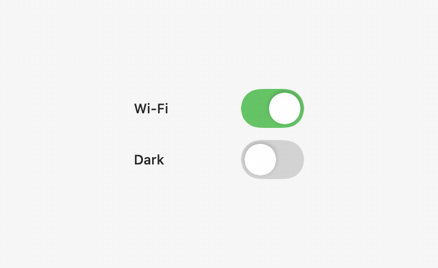<br>
<a href="https://github.com/BigTsung/SwiftUI-Motion-Library/blob/main/Sources/MotionLibrary/Button/LiquidToggleStyle.swift"><b>Liquid Toggle</b></a><br>
<sub>點擊</sub><br>
<code>.toggleStyle(.liquid)</code>
</td>
<td align="center" valign="top" width="33%">
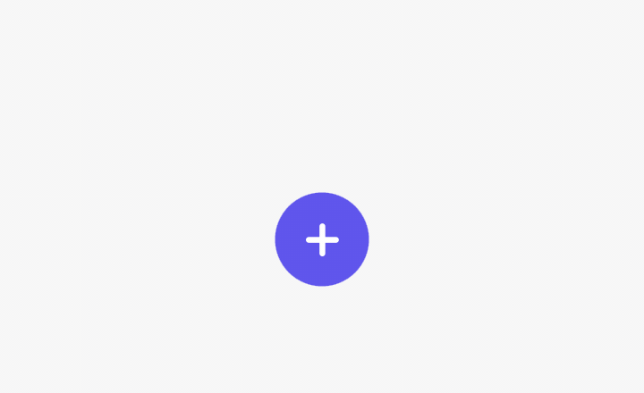<br>
<a href="https://github.com/BigTsung/SwiftUI-Motion-Library/blob/main/Sources/MotionLibrary/Button/GooeyMenu.swift"><b>Gooey Menu</b></a><br>
<sub>點擊</sub><br>
<code>GooeyMenu(symbols:action:)</code>
</td>
<td align="center" valign="top" width="33%">
<br>
<a href="https://github.com/BigTsung/SwiftUI-Motion-Library/blob/main/Sources/MotionLibrary/Button/SlideToConfirm.swift"><b>Slide to Confirm</b></a><br>
<sub>拖曳</sub><br>
<code>SlideToConfirm(_:action:)</code><br><sub>直接複製檔案時，還需要 <a href="https://github.com/BigTsung/SwiftUI-Motion-Library/blob/main/Sources/MotionLibrary/Support/Haptics.swift">Haptics.swift</a></sub>
</td>
</tr>
<tr>
<td align="center" valign="top" width="33%">
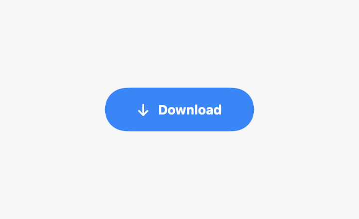<br>
<a href="https://github.com/BigTsung/SwiftUI-Motion-Library/blob/main/Sources/MotionLibrary/Button/DownloadButton.swift"><b>Download Button</b></a><br>
<sub>點擊 / 數值改變</sub><br>
<code>DownloadButton(progress:action:)</code><br><sub>直接複製檔案時，還需要 <a href="https://github.com/BigTsung/SwiftUI-Motion-Library/blob/main/Sources/MotionLibrary/Support/Haptics.swift">Haptics.swift</a></sub>
</td>
<td align="center" valign="top" width="33%">
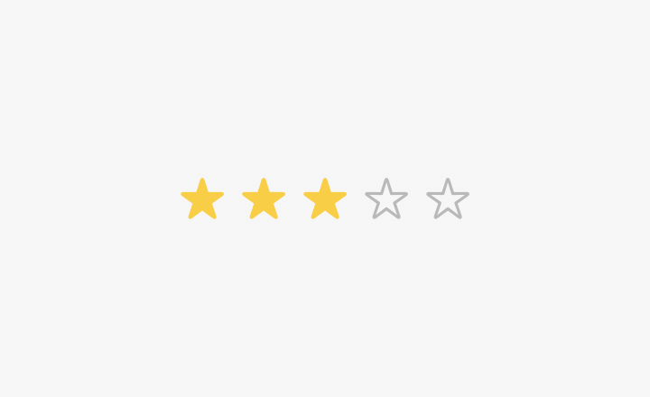<br>
<a href="https://github.com/BigTsung/SwiftUI-Motion-Library/blob/main/Sources/MotionLibrary/Button/StarRating.swift"><b>Star Rating</b></a><br>
<sub>點擊 / 數值改變</sub><br>
<code>StarRating(rating:)</code><br><sub>直接複製檔案時，還需要 <a href="https://github.com/BigTsung/SwiftUI-Motion-Library/blob/main/Sources/MotionLibrary/Support/Haptics.swift">Haptics.swift</a></sub>
</td>
<td align="center" valign="top" width="33%">
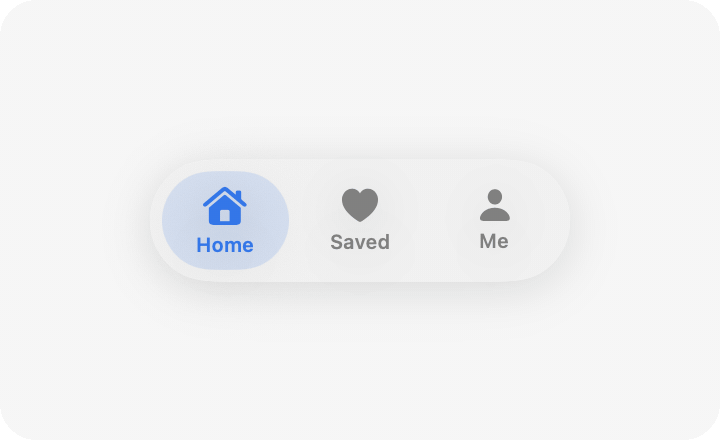<br>
<a href="https://github.com/BigTsung/SwiftUI-Motion-Library/blob/main/Sources/MotionLibrary/Button/BouncyTabBar.swift"><b>Bouncy Tab Bar</b></a><br>
<sub>點擊 / 數值改變</sub><br>
<code>BouncyTabBar(selection:items:)</code><br><sub>直接複製檔案時，還需要 <a href="https://github.com/BigTsung/SwiftUI-Motion-Library/blob/main/Sources/MotionLibrary/Support/Haptics.swift">Haptics.swift</a></sub>
</td>
</tr>
<tr>
<td align="center" valign="top" width="33%">
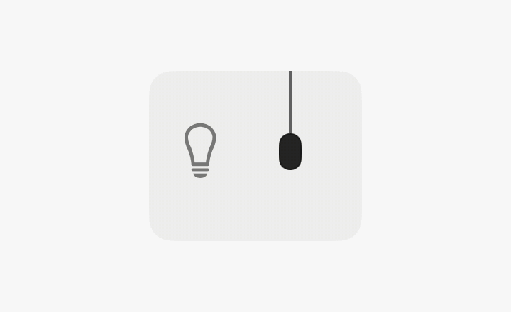<br>
<a href="https://github.com/BigTsung/SwiftUI-Motion-Library/blob/main/Sources/MotionLibrary/Button/PullCord.swift"><b>Pull Cord</b></a><br>
<sub>拖曳 / 點擊</sub><br>
<code>PullCord(isOn:)</code><br><sub>直接複製檔案時，還需要 <a href="https://github.com/BigTsung/SwiftUI-Motion-Library/blob/main/Sources/MotionLibrary/Support/Haptics.swift">Haptics.swift</a></sub>
</td>
</tr>
</table>

### 卡片與群組

<table>
<tr>
<td align="center" valign="top" width="33%">
<br>
<a href="https://github.com/BigTsung/SwiftUI-Motion-Library/blob/main/Sources/MotionLibrary/Card/StaggeredAppear.swift"><b>Staggered Entrance</b></a><br>
<sub>進場</sub><br>
<code>.staggeredAppear(index:)</code>
</td>
<td align="center" valign="top" width="33%">
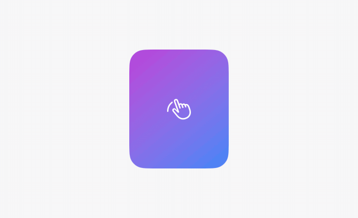<br>
<a href="https://github.com/BigTsung/SwiftUI-Motion-Library/blob/main/Sources/MotionLibrary/Card/Tilt.swift"><b>3D Tilt</b></a><br>
<sub>拖曳</sub><br>
<code>.tiltOnDrag()</code>
</td>
<td align="center" valign="top" width="33%">
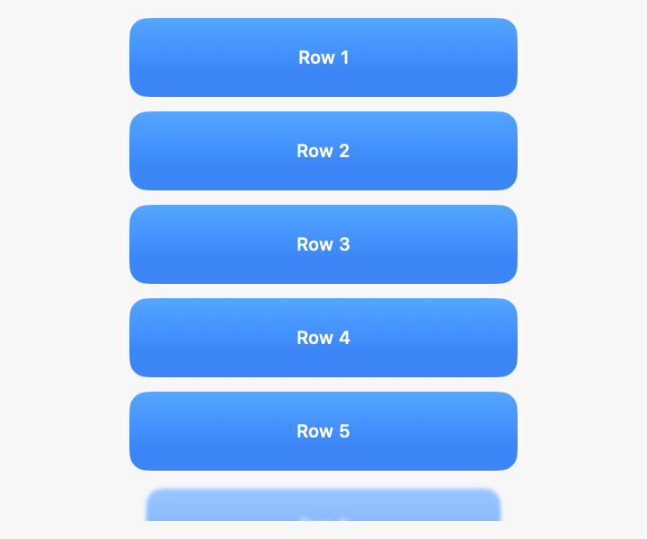<br>
<a href="https://github.com/BigTsung/SwiftUI-Motion-Library/blob/main/Sources/MotionLibrary/Card/ScrollReveal.swift"><b>Scroll Reveal</b></a><br>
<sub>捲動</sub><br>
<code>.scrollReveal()</code>
</td>
</tr>
<tr>
<td align="center" valign="top" width="33%">
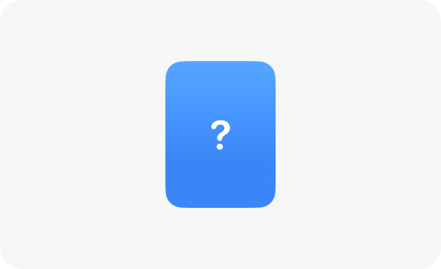<br>
<a href="https://github.com/BigTsung/SwiftUI-Motion-Library/blob/main/Sources/MotionLibrary/Card/FlipCard.swift"><b>Flip Card</b></a><br>
<sub>點擊 / 數值改變</sub><br>
<code>FlipCard(isFlipped:) { } back: { }</code>
</td>
<td align="center" valign="top" width="33%">
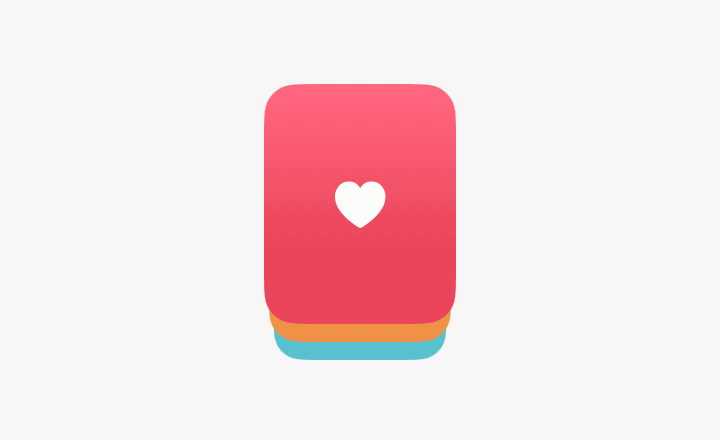<br>
<a href="https://github.com/BigTsung/SwiftUI-Motion-Library/blob/main/Sources/MotionLibrary/Card/SwipeCardStack.swift"><b>Swipe Card Stack</b></a><br>
<sub>拖曳</sub><br>
<code>SwipeCardStack(items) { item in }</code>
</td>
<td align="center" valign="top" width="33%">
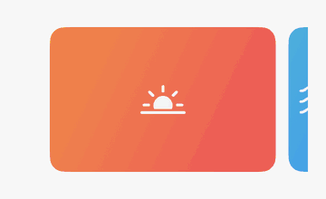<br>
<a href="https://github.com/BigTsung/SwiftUI-Motion-Library/blob/main/Sources/MotionLibrary/Card/ParallaxCarousel.swift"><b>Parallax Carousel</b></a><br>
<sub>捲動</sub><br>
<code>ParallaxCarousel(items) { item in }</code>
</td>
</tr>
<tr>
<td align="center" valign="top" width="33%">
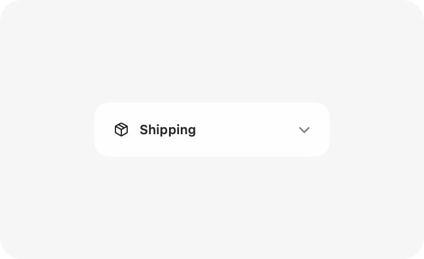<br>
<a href="https://github.com/BigTsung/SwiftUI-Motion-Library/blob/main/Sources/MotionLibrary/Card/ExpandableCard.swift"><b>Expandable Card</b></a><br>
<sub>點擊</sub><br>
<code>ExpandableCard(isExpanded:) { } detail: { }</code>
</td>
<td align="center" valign="top" width="33%">
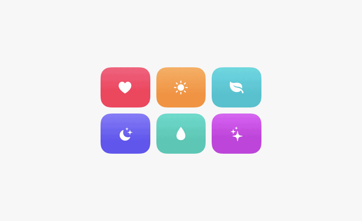<br>
<a href="https://github.com/BigTsung/SwiftUI-Motion-Library/blob/main/Sources/MotionLibrary/Card/HeroGrid.swift"><b>Hero Expand</b></a><br>
<sub>點擊</sub><br>
<code>HeroGrid(items) { thumbnail } detail: { }</code>
</td>
<td align="center" valign="top" width="33%">
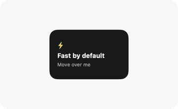<br>
<a href="https://github.com/BigTsung/SwiftUI-Motion-Library/blob/main/Sources/MotionLibrary/Card/Spotlight.swift"><b>Spotlight Card</b></a><br>
<sub>懸停 / 拖曳</sub><br>
<code>.spotlight()</code>
</td>
</tr>
<tr>
<td align="center" valign="top" width="33%">
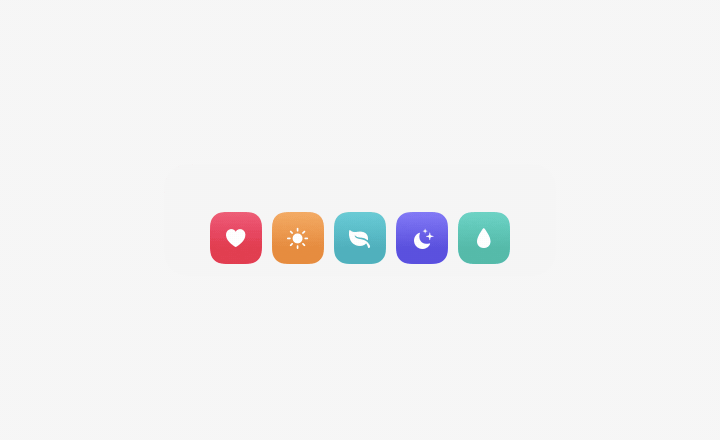<br>
<a href="https://github.com/BigTsung/SwiftUI-Motion-Library/blob/main/Sources/MotionLibrary/Card/MagnifyingDock.swift"><b>Magnifying Dock</b></a><br>
<sub>懸停 / 拖曳</sub><br>
<code>MagnifyingDock(items) { item in }</code>
</td>
<td align="center" valign="top" width="33%">
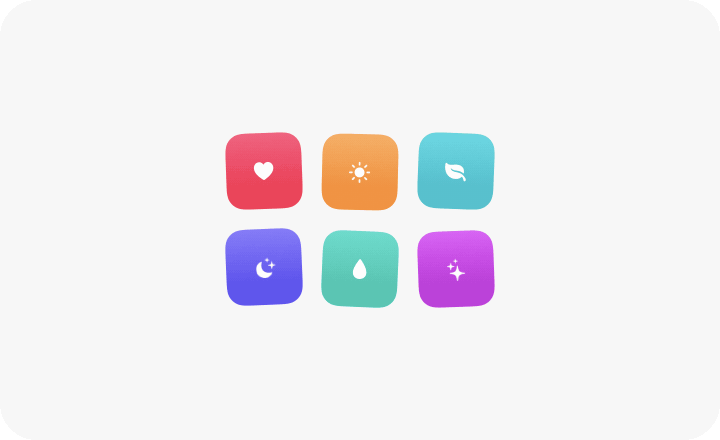<br>
<a href="https://github.com/BigTsung/SwiftUI-Motion-Library/blob/main/Sources/MotionLibrary/Card/Jiggle.swift"><b>Jiggle</b></a><br>
<sub>循環 / 數值改變</sub><br>
<code>.jiggle(isActive:)</code>
</td>
<td align="center" valign="top" width="33%">
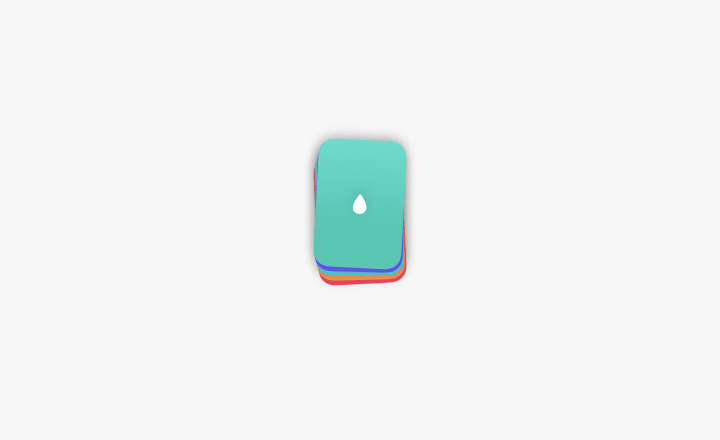<br>
<a href="https://github.com/BigTsung/SwiftUI-Motion-Library/blob/main/Sources/MotionLibrary/Card/FanStack.swift"><b>Fan Stack</b></a><br>
<sub>點擊 / 數值改變</sub><br>
<code>FanStack(items, isSpread:) { item in }</code>
</td>
</tr>
<tr>
<td align="center" valign="top" width="33%">
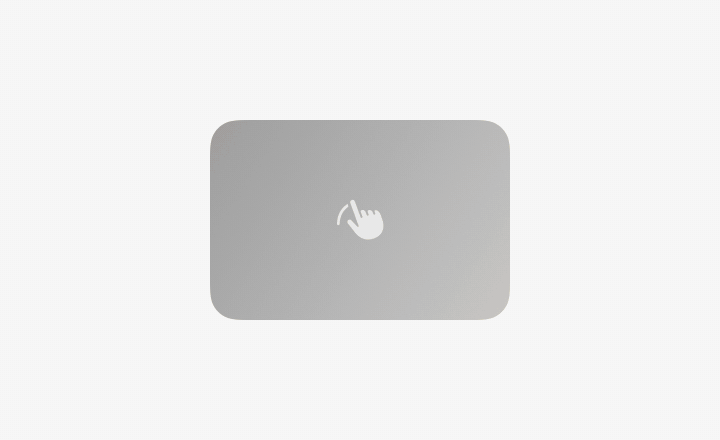<br>
<a href="https://github.com/BigTsung/SwiftUI-Motion-Library/blob/main/Sources/MotionLibrary/Card/ScratchCard.swift"><b>Scratch Card</b></a><br>
<sub>拖曳</sub><br>
<code>.scratchToReveal(_:onReveal:)</code>
</td>
<td align="center" valign="top" width="33%">
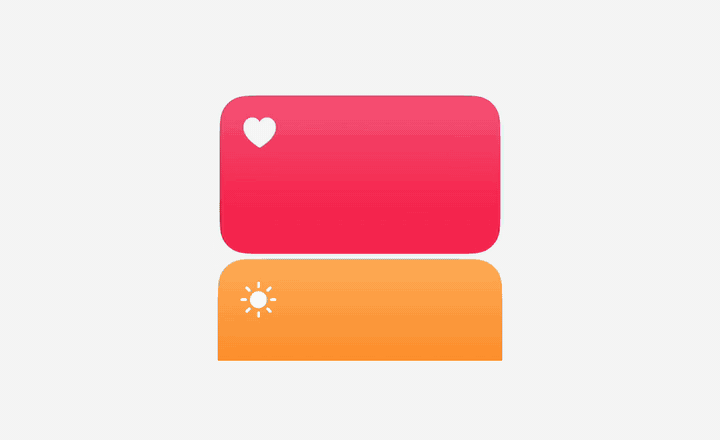<br>
<a href="https://github.com/BigTsung/SwiftUI-Motion-Library/blob/main/Sources/MotionLibrary/Card/StackingCards.swift"><b>Stacking Cards</b></a><br>
<sub>捲動</sub><br>
<code>.stackingCard()</code>
</td>
<td align="center" valign="top" width="33%">
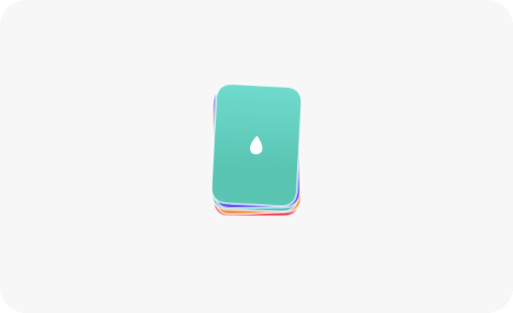<br>
<a href="https://github.com/BigTsung/SwiftUI-Motion-Library/blob/main/Sources/MotionLibrary/Card/DeckShuffle.swift"><b>Deck Shuffle</b></a><br>
<sub>數值改變 / 點擊</sub><br>
<code>DeckShuffle(_:trigger:content:)</code>
</td>
</tr>
<tr>
<td align="center" valign="top" width="33%">
<br>
<a href="https://github.com/BigTsung/SwiftUI-Motion-Library/blob/main/Sources/MotionLibrary/Card/LoopingCarousel.swift"><b>Looping Carousel</b></a><br>
<sub>拖曳 / 循環</sub><br>
<code>LoopingCarousel(_:autoplay:content:)</code>
</td>
<td align="center" valign="top" width="33%">
<br>
<a href="https://github.com/BigTsung/SwiftUI-Motion-Library/blob/main/Sources/MotionLibrary/Card/DragToDismiss.swift"><b>Drag to Dismiss</b></a><br>
<sub>拖曳</sub><br>
<code>.dragToDismiss(isPresented:)</code>
</td>
<td align="center" valign="top" width="33%">
<br>
<a href="https://github.com/BigTsung/SwiftUI-Motion-Library/blob/main/Sources/MotionLibrary/Card/ScrollHeaders.swift"><b>Shrinking Header</b></a><br>
<sub>捲動</sub><br>
<code>.shrinkingHeader()</code>
</td>
</tr>
<tr>
<td align="center" valign="top" width="33%">
<br>
<a href="https://github.com/BigTsung/SwiftUI-Motion-Library/blob/main/Sources/MotionLibrary/Card/ScrollHeaders.swift"><b>Stretchy Header</b></a><br>
<sub>捲動</sub><br>
<code>.stretchyHeader()</code>
</td>
<td align="center" valign="top" width="33%">
<br>
<a href="https://github.com/BigTsung/SwiftUI-Motion-Library/blob/main/Sources/MotionLibrary/Card/IslandPill.swift"><b>Island Pill</b></a><br>
<sub>點擊 / 數值改變</sub><br>
<code>IslandPill(isExpanded:compact:expanded:)</code>
</td>
<td align="center" valign="top" width="33%">
<br>
<a href="https://github.com/BigTsung/SwiftUI-Motion-Library/blob/main/Sources/MotionLibrary/Card/HoverLift.swift"><b>Hover Lift</b></a><br>
<sub>懸停</sub><br>
<code>.hoverLift(isActive:)</code>
</td>
</tr>
<tr>
<td align="center" valign="top" width="33%">
<br>
<a href="https://github.com/BigTsung/SwiftUI-Motion-Library/blob/main/Sources/MotionLibrary/Card/MarqueeWall.swift"><b>Marquee Wall</b></a><br>
<sub>循環</sub><br>
<code>MarqueeWall(count:columns:content:)</code>
</td>
<td align="center" valign="top" width="33%">
<br>
<a href="https://github.com/BigTsung/SwiftUI-Motion-Library/blob/main/Sources/MotionLibrary/Card/PhotoDevelop.swift"><b>Photo Develop</b></a><br>
<sub>進場 / 數值改變</sub><br>
<code>.photoDevelop()</code>
</td>
</tr>
</table>

### 圖形

<table>
<tr>
<td align="center" valign="top" width="33%">
<br>
<a href="https://github.com/BigTsung/SwiftUI-Motion-Library/blob/main/Sources/MotionLibrary/Shape/PulseRings.swift"><b>Pulse Rings</b></a><br>
<sub>循環</sub><br>
<code>PulseRings()</code>
</td>
<td align="center" valign="top" width="33%">
<br>
<a href="https://github.com/BigTsung/SwiftUI-Motion-Library/blob/main/Sources/MotionLibrary/Shape/Burst.swift"><b>Like Burst</b></a><br>
<sub>點擊 / 數值改變</sub><br>
<code>.burst(trigger:)</code>
</td>
<td align="center" valign="top" width="33%">
<br>
<a href="https://github.com/BigTsung/SwiftUI-Motion-Library/blob/main/Sources/MotionLibrary/Shape/AnimatedCheckmark.swift"><b>Checkmark Draw</b></a><br>
<sub>數值改變</sub><br>
<code>AnimatedCheckmark(isChecked:)</code><br><sub>直接複製檔案時，還需要 <a href="https://github.com/BigTsung/SwiftUI-Motion-Library/blob/main/Sources/MotionLibrary/Support/CheckmarkShape.swift">CheckmarkShape.swift</a></sub>
</td>
</tr>
<tr>
<td align="center" valign="top" width="33%">
<br>
<a href="https://github.com/BigTsung/SwiftUI-Motion-Library/blob/main/Sources/MotionLibrary/Shape/Confetti.swift"><b>Confetti</b></a><br>
<sub>點擊 / 數值改變</sub><br>
<code>.confetti(trigger:)</code>
</td>
<td align="center" valign="top" width="33%">
<br>
<a href="https://github.com/BigTsung/SwiftUI-Motion-Library/blob/main/Sources/MotionLibrary/Shape/MotionLoader.swift"><b>Loaders</b></a><br>
<sub>循環</sub><br>
<code>MotionLoader(.spinner)</code>
</td>
<td align="center" valign="top" width="33%">
<br>
<a href="https://github.com/BigTsung/SwiftUI-Motion-Library/blob/main/Sources/MotionLibrary/Shape/MorphingBlob.swift"><b>Morphing Blob</b></a><br>
<sub>循環</sub><br>
<code>MorphingBlob()</code>
</td>
</tr>
<tr>
<td align="center" valign="top" width="33%">
<br>
<a href="https://github.com/BigTsung/SwiftUI-Motion-Library/blob/main/Sources/MotionLibrary/Shape/DrawOn.swift"><b>Draw On</b></a><br>
<sub>進場 / 數值改變</sub><br>
<code>Shape.drawOn()</code>
</td>
<td align="center" valign="top" width="33%">
<br>
<a href="https://github.com/BigTsung/SwiftUI-Motion-Library/blob/main/Sources/MotionLibrary/Shape/ProgressRing.swift"><b>Progress Ring</b></a><br>
<sub>數值改變</sub><br>
<code>ProgressRing(progress:)</code>
</td>
<td align="center" valign="top" width="33%">
<br>
<a href="https://github.com/BigTsung/SwiftUI-Motion-Library/blob/main/Sources/MotionLibrary/Shape/Skeleton.swift"><b>Skeleton</b></a><br>
<sub>循環 / 數值改變</sub><br>
<code>.skeleton(isLoading:)</code><br><sub>直接複製檔案時，還需要 <a href="https://github.com/BigTsung/SwiftUI-Motion-Library/blob/main/Sources/MotionLibrary/Text/Shimmer.swift">Shimmer.swift</a></sub>
</td>
</tr>
<tr>
<td align="center" valign="top" width="33%">
<br>
<a href="https://github.com/BigTsung/SwiftUI-Motion-Library/blob/main/Sources/MotionLibrary/Shape/SlidingTabs.swift"><b>Sliding Tabs</b></a><br>
<sub>點擊</sub><br>
<code>SlidingTabs([…], selection:)</code>
</td>
<td align="center" valign="top" width="33%">
<br>
<a href="https://github.com/BigTsung/SwiftUI-Motion-Library/blob/main/Sources/MotionLibrary/Shape/ReadingProgress.swift"><b>Reading Progress</b></a><br>
<sub>捲動</sub><br>
<code>ReadingProgressScrollView { … }</code>
</td>
</tr>
</table>

### 背景

<table>
<tr>
<td align="center" valign="top" width="33%">
<br>
<a href="https://github.com/BigTsung/SwiftUI-Motion-Library/blob/main/Sources/MotionLibrary/Background/AuroraBackground.swift"><b>Aurora</b></a><br>
<sub>循環</sub><br>
<code>AuroraBackground()</code>
</td>
<td align="center" valign="top" width="33%">
<br>
<a href="https://github.com/BigTsung/SwiftUI-Motion-Library/blob/main/Sources/MotionLibrary/Background/AnimatedMeshGradient.swift"><b>Mesh Gradient</b></a><br>
<sub>循環 · iOS 18+</sub><br>
<code>AnimatedMeshGradient()</code>
</td>
<td align="center" valign="top" width="33%">
<br>
<a href="https://github.com/BigTsung/SwiftUI-Motion-Library/blob/main/Sources/MotionLibrary/Background/RetroGrid.swift"><b>Retro Grid</b></a><br>
<sub>循環</sub><br>
<code>RetroGrid()</code>
</td>
</tr>
<tr>
<td align="center" valign="top" width="33%">
<br>
<a href="https://github.com/BigTsung/SwiftUI-Motion-Library/blob/main/Sources/MotionLibrary/Background/BorderBeam.swift"><b>Border Beam</b></a><br>
<sub>循環</sub><br>
<code>.borderBeam()</code>
</td>
<td align="center" valign="top" width="33%">
<br>
<a href="https://github.com/BigTsung/SwiftUI-Motion-Library/blob/main/Sources/MotionLibrary/Background/WaveBackground.swift"><b>Waves</b></a><br>
<sub>循環</sub><br>
<code>WaveBackground()</code>
</td>
<td align="center" valign="top" width="33%">
<br>
<a href="https://github.com/BigTsung/SwiftUI-Motion-Library/blob/main/Sources/MotionLibrary/Background/Grain.swift"><b>Film Grain</b></a><br>
<sub>循環</sub><br>
<code>.grain()</code><br><sub>直接複製檔案時，還需要 <a href="https://github.com/BigTsung/SwiftUI-Motion-Library/blob/main/Sources/MotionLibrary/Support/SeededRandom.swift">SeededRandom.swift</a></sub>
</td>
</tr>
<tr>
<td align="center" valign="top" width="33%">
<br>
<a href="https://github.com/BigTsung/SwiftUI-Motion-Library/blob/main/Sources/MotionLibrary/Background/Flashlight.swift"><b>Flashlight</b></a><br>
<sub>懸停 / 拖曳</sub><br>
<code>.flashlight()</code>
</td>
<td align="center" valign="top" width="33%">
<br>
<a href="https://github.com/BigTsung/SwiftUI-Motion-Library/blob/main/Sources/MotionLibrary/Background/LavaLamp.swift"><b>Lava Lamp</b></a><br>
<sub>循環</sub><br>
<code>LavaLamp()</code>
</td>
<td align="center" valign="top" width="33%">
<br>
<a href="https://github.com/BigTsung/SwiftUI-Motion-Library/blob/main/Sources/MotionLibrary/Background/MatrixRain.swift"><b>Matrix Rain</b></a><br>
<sub>循環</sub><br>
<code>MatrixRain()</code>
</td>
</tr>
<tr>
<td align="center" valign="top" width="33%">
<br>
<a href="https://github.com/BigTsung/SwiftUI-Motion-Library/blob/main/Sources/MotionLibrary/Background/InteractiveDotGrid.swift"><b>Interactive Dot Grid</b></a><br>
<sub>拖曳 / 懸停 / 循環</sub><br>
<code>InteractiveDotGrid()</code>
</td>
<td align="center" valign="top" width="33%">
<br>
<a href="https://github.com/BigTsung/SwiftUI-Motion-Library/blob/main/Sources/MotionLibrary/Background/Meteors.swift"><b>Meteors</b></a><br>
<sub>循環</sub><br>
<code>Meteors()</code>
</td>
<td align="center" valign="top" width="33%">
<br>
<a href="https://github.com/BigTsung/SwiftUI-Motion-Library/blob/main/Sources/MotionLibrary/Background/FlowField.swift"><b>Flow Field</b></a><br>
<sub>循環</sub><br>
<code>FlowField()</code>
</td>
</tr>
<tr>
<td align="center" valign="top" width="33%">
<br>
<a href="https://github.com/BigTsung/SwiftUI-Motion-Library/blob/main/Sources/MotionLibrary/Background/NetworkBackground.swift"><b>Network</b></a><br>
<sub>循環 / 懸停 / 拖曳</sub><br>
<code>NetworkBackground()</code>
</td>
<td align="center" valign="top" width="33%">
<br>
<a href="https://github.com/BigTsung/SwiftUI-Motion-Library/blob/main/Sources/MotionLibrary/Background/TopographicLines.swift"><b>Topographic Lines</b></a><br>
<sub>循環</sub><br>
<code>TopographicLines()</code>
</td>
<td align="center" valign="top" width="33%">
<br>
<a href="https://github.com/BigTsung/SwiftUI-Motion-Library/blob/main/Sources/MotionLibrary/Background/DayNightSky.swift"><b>Day &amp; Night Sky</b></a><br>
<sub>循環 / 數值改變</sub><br>
<code>DayNightSky(time:)</code>
</td>
</tr>
</table>

### 數字

<table>
<tr>
<td align="center" valign="top" width="33%">
<br>
<a href="https://github.com/BigTsung/SwiftUI-Motion-Library/blob/main/Sources/MotionLibrary/Number/RollingNumber.swift"><b>Rolling Number</b></a><br>
<sub>數值改變</sub><br>
<code>RollingNumber(value:)</code>
</td>
<td align="center" valign="top" width="33%">
<br>
<a href="https://github.com/BigTsung/SwiftUI-Motion-Library/blob/main/Sources/MotionLibrary/Number/SplitFlap.swift"><b>Split-Flap Display</b></a><br>
<sub>數值改變</sub><br>
<code>SplitFlapText(_:)</code>
</td>
<td align="center" valign="top" width="33%">
<br>
<a href="https://github.com/BigTsung/SwiftUI-Motion-Library/blob/main/Sources/MotionLibrary/Number/SlotMachineNumber.swift"><b>Slot Machine</b></a><br>
<sub>數值改變</sub><br>
<code>SlotMachineNumber(value:)</code>
</td>
</tr>
<tr>
<td align="center" valign="top" width="33%">
<br>
<a href="https://github.com/BigTsung/SwiftUI-Motion-Library/blob/main/Sources/MotionLibrary/Number/PriceTicker.swift"><b>Price Ticker</b></a><br>
<sub>數值改變</sub><br>
<code>PriceTicker(value:)</code>
</td>
<td align="center" valign="top" width="33%">
<br>
<a href="https://github.com/BigTsung/SwiftUI-Motion-Library/blob/main/Sources/MotionLibrary/Number/AnimatedChart.swift"><b>Animated Chart</b></a><br>
<sub>進場 / 數值改變</sub><br>
<code>GrowingBarChart(values:) / DrawingLineChart(values:)</code>
</td>
<td align="center" valign="top" width="33%">
<br>
<a href="https://github.com/BigTsung/SwiftUI-Motion-Library/blob/main/Sources/MotionLibrary/Number/NeedleGauge.swift"><b>Needle Gauge</b></a><br>
<sub>數值改變</sub><br>
<code>NeedleGauge(value:)</code>
</td>
</tr>
<tr>
<td align="center" valign="top" width="33%">
<br>
<a href="https://github.com/BigTsung/SwiftUI-Motion-Library/blob/main/Sources/MotionLibrary/Number/ContributionGrid.swift"><b>Contribution Grid</b></a><br>
<sub>進場 / 數值改變</sub><br>
<code>ContributionGrid(values:)</code>
</td>
<td align="center" valign="top" width="33%">
<br>
<a href="https://github.com/BigTsung/SwiftUI-Motion-Library/blob/main/Sources/MotionLibrary/Number/AnalogClock.swift"><b>Analog Clock</b></a><br>
<sub>循環 / 數值改變</sub><br>
<code>AnalogClock(date:)</code>
</td>
</tr>
</table>

### 粒子與 3D

<table>
<tr>
<td align="center" valign="top" width="33%">
<br>
<a href="https://github.com/BigTsung/SwiftUI-Motion-Library/blob/main/Sources/MotionLibrary/Particle/ParticleField.swift"><b>Particle Field</b></a><br>
<sub>循環</sub><br>
<code>ParticleField()</code><br><sub>直接複製檔案時，還需要 <a href="https://github.com/BigTsung/SwiftUI-Motion-Library/blob/main/Sources/MotionLibrary/Support/SeededRandom.swift">SeededRandom.swift</a></sub>
</td>
<td align="center" valign="top" width="33%">
<br>
<a href="https://github.com/BigTsung/SwiftUI-Motion-Library/blob/main/Sources/MotionLibrary/Particle/Starfield.swift"><b>Starfield</b></a><br>
<sub>循環</sub><br>
<code>Starfield()</code><br><sub>直接複製檔案時，還需要 <a href="https://github.com/BigTsung/SwiftUI-Motion-Library/blob/main/Sources/MotionLibrary/Support/SeededRandom.swift">SeededRandom.swift</a></sub>
</td>
<td align="center" valign="top" width="33%">
<br>
<a href="https://github.com/BigTsung/SwiftUI-Motion-Library/blob/main/Sources/MotionLibrary/Particle/CoverFlow.swift"><b>Cover Flow</b></a><br>
<sub>捲動</sub><br>
<code>CoverFlow(items) { item in }</code>
</td>
</tr>
<tr>
<td align="center" valign="top" width="33%">
<br>
<a href="https://github.com/BigTsung/SwiftUI-Motion-Library/blob/main/Sources/MotionLibrary/Particle/Float3D.swift"><b>Float 3D</b></a><br>
<sub>循環</sub><br>
<code>.float3D()</code>
</td>
<td align="center" valign="top" width="33%">
<br>
<a href="https://github.com/BigTsung/SwiftUI-Motion-Library/blob/main/Sources/MotionLibrary/Particle/Fireworks.swift"><b>Fireworks</b></a><br>
<sub>循環</sub><br>
<code>Fireworks()</code><br><sub>直接複製檔案時，還需要 <a href="https://github.com/BigTsung/SwiftUI-Motion-Library/blob/main/Sources/MotionLibrary/Support/SeededRandom.swift">SeededRandom.swift</a></sub>
</td>
<td align="center" valign="top" width="33%">
<br>
<a href="https://github.com/BigTsung/SwiftUI-Motion-Library/blob/main/Sources/MotionLibrary/Particle/Snowfall.swift"><b>Snowfall &amp; Rain</b></a><br>
<sub>循環</sub><br>
<code>Snowfall(.snow / .rain)</code><br><sub>直接複製檔案時，還需要 <a href="https://github.com/BigTsung/SwiftUI-Motion-Library/blob/main/Sources/MotionLibrary/Support/SeededRandom.swift">SeededRandom.swift</a></sub>
</td>
</tr>
<tr>
<td align="center" valign="top" width="33%">
<br>
<a href="https://github.com/BigTsung/SwiftUI-Motion-Library/blob/main/Sources/MotionLibrary/Particle/FloatingReactions.swift"><b>Floating Reactions</b></a><br>
<sub>點擊 / 數值改變</sub><br>
<code>.floatingReactions(trigger:)</code>
</td>
<td align="center" valign="top" width="33%">
<br>
<a href="https://github.com/BigTsung/SwiftUI-Motion-Library/blob/main/Sources/MotionLibrary/Particle/WarpTunnel.swift"><b>Warp Tunnel</b></a><br>
<sub>循環</sub><br>
<code>WarpTunnel()</code>
</td>
<td align="center" valign="top" width="33%">
<br>
<a href="https://github.com/BigTsung/SwiftUI-Motion-Library/blob/main/Sources/MotionLibrary/Particle/Holographic.swift"><b>Holographic Card</b></a><br>
<sub>懸停 / 拖曳</sub><br>
<code>.holographic()</code>
</td>
</tr>
<tr>
<td align="center" valign="top" width="33%">
<br>
<a href="https://github.com/BigTsung/SwiftUI-Motion-Library/blob/main/Sources/MotionLibrary/Particle/PhysicsEmoji.swift"><b>Physics Emoji</b></a><br>
<sub>數值改變 / 點擊</sub><br>
<code>PhysicsEmoji(trigger:)</code>
</td>
<td align="center" valign="top" width="33%">
<br>
<a href="https://github.com/BigTsung/SwiftUI-Motion-Library/blob/main/Sources/MotionLibrary/Particle/Shatter.swift"><b>Shatter</b></a><br>
<sub>數值改變</sub><br>
<code>.transition(.shatter)</code>
</td>
<td align="center" valign="top" width="33%">
<br>
<a href="https://github.com/BigTsung/SwiftUI-Motion-Library/blob/main/Sources/MotionLibrary/Particle/CubeTransition.swift"><b>3D Cube</b></a><br>
<sub>數值改變</sub><br>
<code>.transition(.cube)</code>
</td>
</tr>
<tr>
<td align="center" valign="top" width="33%">
<br>
<a href="https://github.com/BigTsung/SwiftUI-Motion-Library/blob/main/Sources/MotionLibrary/Particle/DotGlobe.swift"><b>Dot Globe</b></a><br>
<sub>循環</sub><br>
<code>DotGlobe()</code>
</td>
<td align="center" valign="top" width="33%">
<br>
<a href="https://github.com/BigTsung/SwiftUI-Motion-Library/blob/main/Sources/MotionLibrary/Particle/Bubbles.swift"><b>Bubbles</b></a><br>
<sub>循環</sub><br>
<code>Bubbles()</code>
</td>
<td align="center" valign="top" width="33%">
<br>
<a href="https://github.com/BigTsung/SwiftUI-Motion-Library/blob/main/Sources/MotionLibrary/Particle/Fireflies.swift"><b>Fireflies</b></a><br>
<sub>循環</sub><br>
<code>Fireflies()</code>
</td>
</tr>
<tr>
<td align="center" valign="top" width="33%">
<br>
<a href="https://github.com/BigTsung/SwiftUI-Motion-Library/blob/main/Sources/MotionLibrary/Particle/Flock.swift"><b>Flock</b></a><br>
<sub>循環 / 拖曳 / 懸停</sub><br>
<code>Flock()</code>
</td>
<td align="center" valign="top" width="33%">
<br>
<a href="https://github.com/BigTsung/SwiftUI-Motion-Library/blob/main/Sources/MotionLibrary/Particle/InkTrail.swift"><b>Ink Trail</b></a><br>
<sub>拖曳 / 懸停</sub><br>
<code>.inkTrail(color:)</code>
</td>
<td align="center" valign="top" width="33%">
<br>
<a href="https://github.com/BigTsung/SwiftUI-Motion-Library/blob/main/Sources/MotionLibrary/Particle/RainOnGlass.swift"><b>Rain on Glass</b></a><br>
<sub>循環</sub><br>
<code>RainOnGlass()</code>
</td>
</tr>
<tr>
<td align="center" valign="top" width="33%">
<br>
<a href="https://github.com/BigTsung/SwiftUI-Motion-Library/blob/main/Sources/MotionLibrary/Particle/Orbits.swift"><b>Orbits</b></a><br>
<sub>循環</sub><br>
<code>Orbits(colors:)</code>
</td>
</tr>
</table>

### 轉場

<table>
<tr>
<td align="center" valign="top" width="33%">
<br>
<a href="https://github.com/BigTsung/SwiftUI-Motion-Library/blob/main/Sources/MotionLibrary/Transition/MaskTransitions.swift"><b>Iris</b></a><br>
<sub>進場</sub><br>
<code>.transition(.iris)</code>
</td>
<td align="center" valign="top" width="33%">
<br>
<a href="https://github.com/BigTsung/SwiftUI-Motion-Library/blob/main/Sources/MotionLibrary/Transition/MaskTransitions.swift"><b>Blinds</b></a><br>
<sub>進場</sub><br>
<code>.transition(.blinds)</code>
</td>
<td align="center" valign="top" width="33%">
<br>
<a href="https://github.com/BigTsung/SwiftUI-Motion-Library/blob/main/Sources/MotionLibrary/Transition/MaskTransitions.swift"><b>Clock Wipe</b></a><br>
<sub>進場</sub><br>
<code>.transition(.clockWipe)</code>
</td>
</tr>
<tr>
<td align="center" valign="top" width="33%">
<br>
<a href="https://github.com/BigTsung/SwiftUI-Motion-Library/blob/main/Sources/MotionLibrary/Transition/MaskTransitions.swift"><b>Pixel Dissolve</b></a><br>
<sub>進場</sub><br>
<code>.transition(.dissolve)</code>
</td>
<td align="center" valign="top" width="33%">
<br>
<a href="https://github.com/BigTsung/SwiftUI-Motion-Library/blob/main/Sources/MotionLibrary/Transition/StyleTransitions.swift"><b>Poof</b></a><br>
<sub>進場</sub><br>
<code>.transition(.poof)</code>
</td>
<td align="center" valign="top" width="33%">
<br>
<a href="https://github.com/BigTsung/SwiftUI-Motion-Library/blob/main/Sources/MotionLibrary/Transition/StyleTransitions.swift"><b>Swoosh</b></a><br>
<sub>進場</sub><br>
<code>.transition(.swoosh)</code>
</td>
</tr>
<tr>
<td align="center" valign="top" width="33%">
<br>
<a href="https://github.com/BigTsung/SwiftUI-Motion-Library/blob/main/Sources/MotionLibrary/Transition/StyleTransitions.swift"><b>Film Exposure</b></a><br>
<sub>進場</sub><br>
<code>.transition(.filmExposure)</code>
</td>
<td align="center" valign="top" width="33%">
<br>
<a href="https://github.com/BigTsung/SwiftUI-Motion-Library/blob/main/Sources/MotionLibrary/Transition/CircularReveal.swift"><b>Circular Reveal</b></a><br>
<sub>點擊 / 數值改變</sub><br>
<code>CircularReveal(value:origin:content:)</code>
</td>
<td align="center" valign="top" width="33%">
<br>
<a href="https://github.com/BigTsung/SwiftUI-Motion-Library/blob/main/Sources/MotionLibrary/Transition/LiquidSwipe.swift"><b>Liquid Swipe</b></a><br>
<sub>數值改變</sub><br>
<code>.transition(.liquidSwipe)</code>
</td>
</tr>
<tr>
<td align="center" valign="top" width="33%">
<br>
<a href="https://github.com/BigTsung/SwiftUI-Motion-Library/blob/main/Sources/MotionLibrary/Transition/PageTurn.swift"><b>Page Turn</b></a><br>
<sub>數值改變</sub><br>
<code>.transition(.pageTurn)</code>
</td>
<td align="center" valign="top" width="33%">
<br>
<a href="https://github.com/BigTsung/SwiftUI-Motion-Library/blob/main/Sources/MotionLibrary/Transition/GlitchTransition.swift"><b>Glitch Transition</b></a><br>
<sub>數值改變</sub><br>
<code>.transition(.glitch)</code><br><sub>直接複製檔案時，還需要 <a href="https://github.com/BigTsung/SwiftUI-Motion-Library/blob/main/Sources/MotionLibrary/Support/GlitchSlice.swift">GlitchSlice.swift</a></sub>
</td>
<td align="center" valign="top" width="33%">
<br>
<a href="https://github.com/BigTsung/SwiftUI-Motion-Library/blob/main/Sources/MotionLibrary/Transition/OrigamiFold.swift"><b>Origami Fold</b></a><br>
<sub>數值改變</sub><br>
<code>.transition(.origami)</code><br><sub>直接複製檔案時，還需要 <a href="https://github.com/BigTsung/SwiftUI-Motion-Library/blob/main/Sources/MotionLibrary/Support/GlitchSlice.swift">GlitchSlice.swift</a></sub>
</td>
</tr>
<tr>
<td align="center" valign="top" width="33%">
<br>
<a href="https://github.com/BigTsung/SwiftUI-Motion-Library/blob/main/Sources/MotionLibrary/Transition/InkBleed.swift"><b>Ink Bleed</b></a><br>
<sub>數值改變</sub><br>
<code>.transition(.inkBleed)</code>
</td>
<td align="center" valign="top" width="33%">
<br>
<a href="https://github.com/BigTsung/SwiftUI-Motion-Library/blob/main/Sources/MotionLibrary/Transition/ZoomBlur.swift"><b>Zoom Blur</b></a><br>
<sub>數值改變</sub><br>
<code>.transition(.zoomBlur)</code>
</td>
</tr>
</table>

### 著色器

<table>
<tr>
<td align="center" valign="top" width="33%">
<br>
<a href="https://github.com/BigTsung/SwiftUI-Motion-Library/blob/main/Sources/MotionShaders/WaterRipple.swift"><b>Water Ripple</b></a><br>
<sub>點擊 / 數值改變</sub><br>
<code>.waterRippleOnTap() / .waterRipple(at:trigger:)</code><br><sub>直接複製檔案時，還需要 <a href="https://github.com/BigTsung/SwiftUI-Motion-Library/blob/main/Sources/MotionShaders/Shaders/WaterRipple.metal">WaterRipple.metal</a></sub>
</td>
<td align="center" valign="top" width="33%">
<br>
<a href="https://github.com/BigTsung/SwiftUI-Motion-Library/blob/main/Sources/MotionShaders/Pixellate.swift"><b>Pixellate</b></a><br>
<sub>數值改變</sub><br>
<code>.pixellate(_:)</code><br><sub>直接複製檔案時，還需要 <a href="https://github.com/BigTsung/SwiftUI-Motion-Library/blob/main/Sources/MotionShaders/Shaders/Pixellate.metal">Pixellate.metal</a></sub>
</td>
<td align="center" valign="top" width="33%">
<br>
<a href="https://github.com/BigTsung/SwiftUI-Motion-Library/blob/main/Sources/MotionShaders/ChromaticAberration.swift"><b>Chromatic Aberration</b></a><br>
<sub>數值改變 / 循環</sub><br>
<code>.chromaticAberration(_:)</code><br><sub>直接複製檔案時，還需要 <a href="https://github.com/BigTsung/SwiftUI-Motion-Library/blob/main/Sources/MotionShaders/Shaders/ChromaticAberration.metal">ChromaticAberration.metal</a></sub>
</td>
</tr>
<tr>
<td align="center" valign="top" width="33%">
<br>
<a href="https://github.com/BigTsung/SwiftUI-Motion-Library/blob/main/Sources/MotionShaders/CRT.swift"><b>CRT Screen</b></a><br>
<sub>循環</sub><br>
<code>.crtScreen()</code><br><sub>直接複製檔案時，還需要 <a href="https://github.com/BigTsung/SwiftUI-Motion-Library/blob/main/Sources/MotionShaders/Shaders/CRT.metal">CRT.metal</a></sub>
</td>
<td align="center" valign="top" width="33%">
<br>
<a href="https://github.com/BigTsung/SwiftUI-Motion-Library/blob/main/Sources/MotionShaders/HeatHaze.swift"><b>Heat Haze</b></a><br>
<sub>循環</sub><br>
<code>.heatHaze(strength:)</code><br><sub>直接複製檔案時，還需要 <a href="https://github.com/BigTsung/SwiftUI-Motion-Library/blob/main/Sources/MotionShaders/Shaders/HeatHaze.metal">HeatHaze.metal</a></sub>
</td>
<td align="center" valign="top" width="33%">
<br>
<a href="https://github.com/BigTsung/SwiftUI-Motion-Library/blob/main/Sources/MotionShaders/NoiseDissolve.swift"><b>Noise Dissolve</b></a><br>
<sub>數值改變</sub><br>
<code>.noiseDissolve(_:) / .transition(.noiseDissolve)</code><br><sub>直接複製檔案時，還需要 <a href="https://github.com/BigTsung/SwiftUI-Motion-Library/blob/main/Sources/MotionShaders/Shaders/NoiseDissolve.metal">NoiseDissolve.metal</a></sub>
</td>
</tr>
<tr>
<td align="center" valign="top" width="33%">
<br>
<a href="https://github.com/BigTsung/SwiftUI-Motion-Library/blob/main/Sources/MotionShaders/Disintegrate.swift"><b>Disintegrate</b></a><br>
<sub>數值改變</sub><br>
<code>.disintegrate(_:) / .transition(.disintegrate)</code><br><sub>直接複製檔案時，還需要 <a href="https://github.com/BigTsung/SwiftUI-Motion-Library/blob/main/Sources/MotionShaders/Shaders/Disintegrate.metal">Disintegrate.metal</a></sub>
</td>
<td align="center" valign="top" width="33%">
<br>
<a href="https://github.com/BigTsung/SwiftUI-Motion-Library/blob/main/Sources/MotionShaders/Genie.swift"><b>Genie</b></a><br>
<sub>數值改變</sub><br>
<code>.genie(_:toward:) / .transition(.genie)</code><br><sub>直接複製檔案時，還需要 <a href="https://github.com/BigTsung/SwiftUI-Motion-Library/blob/main/Sources/MotionShaders/Shaders/Genie.metal">Genie.metal</a></sub>
</td>
<td align="center" valign="top" width="33%">
<br>
<a href="https://github.com/BigTsung/SwiftUI-Motion-Library/blob/main/Sources/MotionShaders/GlassLens.swift"><b>Glass Lens</b></a><br>
<sub>拖曳 / 懸停</sub><br>
<code>.glassLensOnDrag() / .glassLens(at:)</code><br><sub>直接複製檔案時，還需要 <a href="https://github.com/BigTsung/SwiftUI-Motion-Library/blob/main/Sources/MotionShaders/Shaders/GlassLens.metal">GlassLens.metal</a></sub>
</td>
</tr>
<tr>
<td align="center" valign="top" width="33%">
<br>
<a href="https://github.com/BigTsung/SwiftUI-Motion-Library/blob/main/Sources/MotionShaders/Swirl.swift"><b>Swirl</b></a><br>
<sub>拖曳 / 數值改變</sub><br>
<code>.swirlOnDrag() / .swirl(at:strength:)</code><br><sub>直接複製檔案時，還需要 <a href="https://github.com/BigTsung/SwiftUI-Motion-Library/blob/main/Sources/MotionShaders/Shaders/Swirl.metal">Swirl.metal</a></sub>
</td>
<td align="center" valign="top" width="33%">
<br>
<a href="https://github.com/BigTsung/SwiftUI-Motion-Library/blob/main/Sources/MotionShaders/Kaleidoscope.swift"><b>Kaleidoscope</b></a><br>
<sub>循環 / 數值改變</sub><br>
<code>.kaleidoscope(segments:)</code><br><sub>直接複製檔案時，還需要 <a href="https://github.com/BigTsung/SwiftUI-Motion-Library/blob/main/Sources/MotionShaders/Shaders/Kaleidoscope.metal">Kaleidoscope.metal</a></sub>
</td>
<td align="center" valign="top" width="33%">
<br>
<a href="https://github.com/BigTsung/SwiftUI-Motion-Library/blob/main/Sources/MotionShaders/Halftone.swift"><b>Halftone</b></a><br>
<sub>數值改變</sub><br>
<code>.halftone(dotSize:)</code><br><sub>直接複製檔案時，還需要 <a href="https://github.com/BigTsung/SwiftUI-Motion-Library/blob/main/Sources/MotionShaders/Shaders/Halftone.metal">Halftone.metal</a></sub>
</td>
</tr>
<tr>
<td align="center" valign="top" width="33%">
<br>
<a href="https://github.com/BigTsung/SwiftUI-Motion-Library/blob/main/Sources/MotionShaders/Dither.swift"><b>Dither</b></a><br>
<sub>數值改變</sub><br>
<code>.dither(pixelSize:palette:)</code><br><sub>直接複製檔案時，還需要 <a href="https://github.com/BigTsung/SwiftUI-Motion-Library/blob/main/Sources/MotionShaders/Shaders/Dither.metal">Dither.metal</a></sub>
</td>
<td align="center" valign="top" width="33%">
<br>
<a href="https://github.com/BigTsung/SwiftUI-Motion-Library/blob/main/Sources/MotionShaders/Thermal.swift"><b>Thermal Vision</b></a><br>
<sub>數值改變</sub><br>
<code>.thermal(_:)</code><br><sub>直接複製檔案時，還需要 <a href="https://github.com/BigTsung/SwiftUI-Motion-Library/blob/main/Sources/MotionShaders/Shaders/Thermal.metal">Thermal.metal</a></sub>
</td>
<td align="center" valign="top" width="33%">
<br>
<a href="https://github.com/BigTsung/SwiftUI-Motion-Library/blob/main/Sources/MotionShaders/FlagWave.swift"><b>Flag Wave</b></a><br>
<sub>循環</sub><br>
<code>.flagWave()</code><br><sub>直接複製檔案時，還需要 <a href="https://github.com/BigTsung/SwiftUI-Motion-Library/blob/main/Sources/MotionShaders/Shaders/FlagWave.metal">FlagWave.metal</a></sub>
</td>
</tr>
<tr>
<td align="center" valign="top" width="33%">
<br>
<a href="https://github.com/BigTsung/SwiftUI-Motion-Library/blob/main/Sources/MotionShaders/Voronoi.swift"><b>Voronoi Cells</b></a><br>
<sub>循環</sub><br>
<code>VoronoiCells(colors:)</code><br><sub>直接複製檔案時，還需要 <a href="https://github.com/BigTsung/SwiftUI-Motion-Library/blob/main/Sources/MotionShaders/Shaders/Voronoi.metal">Voronoi.metal</a></sub>
</td>
</tr>
</table>
<!-- effects:end -->

預覽 GIF 是用 `Scripts/record-readme-gifs.sh`（macOS，需要 ffmpeg）從 Gallery 的 Demo 錄製的。它在螢幕外渲染，錄製時你可以照常工作。

## 參與貢獻

非常歡迎新增效果！請看 [CONTRIBUTING.md](CONTRIBUTING.md)。每個效果就是一個原始碼檔案、一個 Demo 畫面和一筆 catalog 資料。

<details>
<summary><b>專案結構</b></summary>

```
Sources/
  MotionLibrary/          # 效果本體（公開 API，零依賴）
    Text/  Button/  Card/  Shape/  Background/  Number/  Particle/  Transition/
  MotionShaders/          # 選用的 Metal 著色器效果（+ Shaders/*.metal）
  MotionGallery/          # catalog 資料 + 瀏覽介面
    Model/MotionEffect.swift
    Catalog/MotionCatalog.swift   # 每個效果一筆資料：唯一的資料來源
    Catalog/Demos.swift           # Demo 畫面
    Views/
Docs/                     # README GIF + motion-catalog.json（自動產生）
llms.txt  llms-full.txt   # 自動產生
skills/  .cursor/rules/   # Agent Skill 和 Cursor rule（自動產生）
mcp/                      # 零依賴的 MCP server
Examples/MotionLibraryDemo/  # iOS 範例 App + 捲動效果 UI 測試
Scripts/
  check-build.sh          # 不需要 Xcode 也能編譯檢查
  generate-docs.sh        # 重新產生所有由 catalog 衍生的檔案
  record-readme-gifs.sh   # 錄製 README GIF（螢幕外渲染）
  record-simulator-gifs.sh  # 需要真實捲動的 GIF（iOS 模擬器）
```

</details>

## 授權

MIT。可以用在商業 App，不需要標示出處（但很歡迎給顆 ⭐）。

---

<div align="center">

⭐ **給這個 repo 一顆星**，如果它幫你省下一個下午調 spring 參數<br>
🧩 **[新增一個效果](CONTRIBUTING.md)**：一個原始碼檔案、一個 Demo、一筆 catalog 資料

</div>
